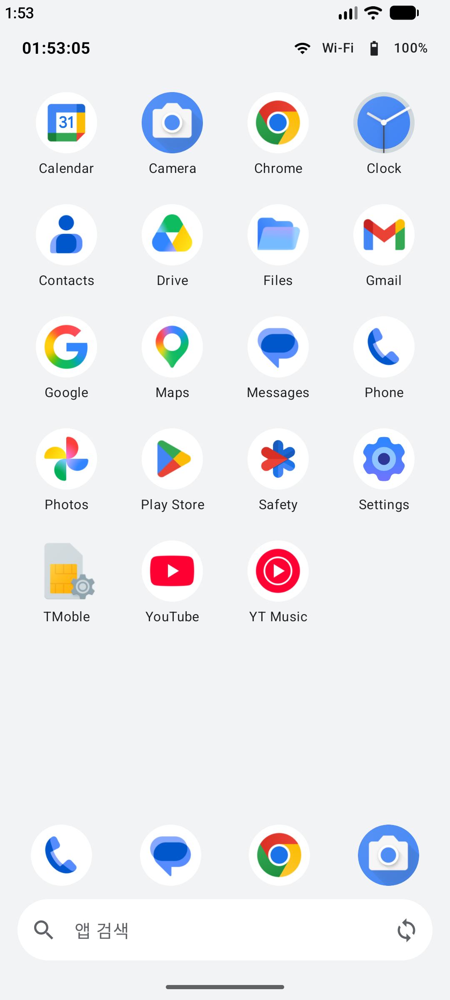
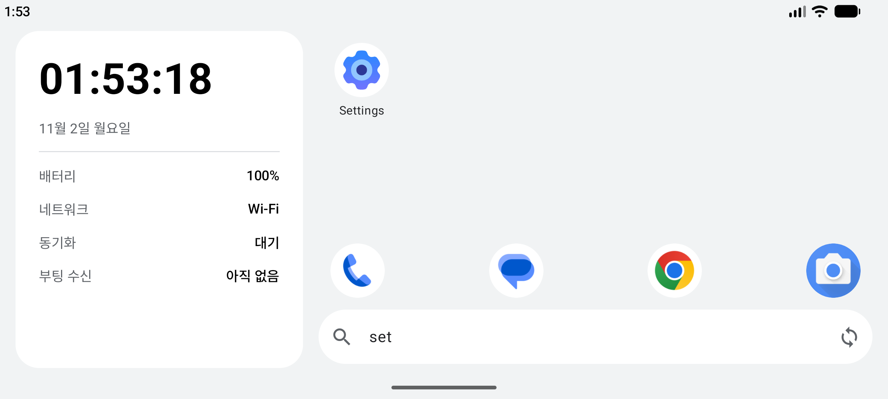

# 미니 런처로 배우는 안드로이드 앱 개발

3일 동안 홈 화면 앱(런처) 하나를 Kotlin과 Jetpack Compose로 만듭니다. 마지막 날에는 이 앱을 에뮬레이터의 기본 홈 앱으로 바꿔서, 홈 버튼을 누르면 직접 만든 화면이 뜨게 합니다.

C++나 다른 언어로 개발해 본 분을 기준으로 만들었습니다. 안드로이드 경험은 없어도 됩니다.

실습 화면 Figma: https://www.figma.com/design/szFZ4g6y6kvu9kJf8WORY0/

노트북 설치 방법(사전 준비 자료): https://docs.google.com/document/d/1CHdVy_S3rRhpeoC8d_mNedPXUOmzFv6yTfOKbkIpVVs/edit?usp=sharing

## 준비

1. 사전 준비 자료(위 링크)의 1부대로 Android Studio Rabbit(2026.2.1 이상)을 설치하고, File > New > New Project > Empty Activity > Finish로 새 프로젝트를 만들어 Run 했을 때 에뮬레이터(Medium Phone)에 Hello World가 뜨는지 확인합니다. 노트북을 준비한 담당자가 이미 해 두었으면 건너뜁니다.
2. 이 페이지 위쪽 초록색 Code 버튼 > Download ZIP으로 코드를 받습니다.
3. 한글이 들어가지 않은 경로에 압축을 풉니다. 예: `C:\Users\Public\minilauncher`.
    Windows 압축 풀기는 폴더를 한 겹 더 만듭니다. 실제로 여는 폴더는 `C:\Users\Public\minilauncher\android-mini-launcher-course-main\step01_project`처럼 step 폴더입니다.
    한글 이름 폴더 아래에서는 빌드가 `Your project path contains non-ASCII characters` 오류로 바로 멈춥니다.
4. Android Studio에서 File > Open을 누르고 step 폴더 하나를 엽니다(예: `step01_project`).
5. 처음 열면 몇 가지 창이 뜹니다.
    - Trust and Open Project 창: Trust Project를 누릅니다.
    - 오른쪽 아래 Project update recommended(AGP 업그레이드) 알림: 누르지 않고 닫습니다. 업그레이드하면 실습 코드와 설정이 달라집니다.
    - Windows Defender 관련 알림: 닫아도 됩니다.
    - 첫 동기화와 빌드는 Gradle, 라이브러리, Android 16 SDK를 받느라 몇 분 걸립니다.
6. 에뮬레이터 언어는 영어 그대로 둡니다. 실습의 메뉴 이름과 앱 이름이 영어 기준입니다.

## Android Studio 기본 조작

처음이면 이것만 알고 시작합니다.

| 하고 싶은 것 | 방법 |
|---|---|
| 모듈 시작 | 모듈마다 그 모듈의 step 폴더를 엽니다. File > Open > 폴더 선택 > This Window. 오른쪽 아래 진행 표시(Gradle 동기화)가 사라질 때까지 기다립니다 |
| 파일 찾기 | Shift를 두 번 누르고 파일 이름(예: `AppIcon.kt`)을 칩니다. 교안의 `ui/AppIcon.kt` 같은 짧은 경로는 `app/src/main/java/com/example/minilauncher/` 아래입니다. 왼쪽 위 Android를 Project로 바꾸면 폴더 그대로 보입니다 |
| 실행 | 위쪽 초록 삼각형(Run). 앱이 오른쪽 Running Devices 창의 에뮬레이터에 뜹니다 |
| 뒤로 가기, 홈 | Running Devices 창 위쪽 도구막대의 ◁(Back), ○(Home) 버튼 |
| 화면 돌리기 | 같은 도구막대의 회전 버튼(Rotate Left, Rotate Right). 앱이 안 돌면 에뮬레이터 화면 위쪽을 끌어내려 Auto-rotate를 켭니다 |
| 앱 서랍 | 홈 화면을 위로 밀어 올리면 나오는 설치 앱 목록입니다. 실험실처럼 아이콘이 따로 생긴 앱은 여기서 엽니다 |
| Logcat 창 | 아래쪽 Logcat 탭, 안 보이면 View > Tool Windows > Logcat |
| 에뮬레이터 버전 | Device Manager에서 기기의 API 숫자를 봅니다. 36은 Android 16, 37은 Android 17입니다 |

그림 속 메뉴 옆 단축키 표시는 Windows와 다를 수 있습니다. 단축키 대신 메뉴나 버튼으로 실행합니다.

## 3일 일정

| 일차 | 시간 | 모듈 | 폴더 |
|---|---|---|---|
| 1일차 | 09:00~10:30 | 1-1 개발 환경 확인과 C++ 개발자를 위한 Kotlin 핵심 | [step01_project](step01_project) |
| | 10:30~12:00 | 1-2 안드로이드 구조와 프로젝트 구성 | [step01_project](step01_project) |
| | 13:00~15:00 | 1-3 Jetpack Compose 기초 | [step02_compose](step02_compose) |
| | 15:00~17:00 | 1-4 Activity 생명주기와 화면 이동 | [step03_lifecycle](step03_lifecycle) |
| 2일차 | 09:00~12:00 | 2-1 메인 스레드와 Coroutine, Flow | [step04_coroutine](step04_coroutine) |
| | 13:00~15:00 | 2-2 시스템 이벤트 감지 (BroadcastReceiver) | [step05_receiver](step05_receiver) |
| | 15:00~17:00 | 2-3 백그라운드 처리 (Service, Notification) | [step06_service](step06_service) |
| 3일차 | 09:00~12:00 | 3-1 HomeScreen(Launcher) 만들기 | [step07_launcher](step07_launcher) |
| | 13:00~15:00 | 3-2 Logcat 로그 분석 | [step07x_bughunt](step07x_bughunt) |
| | 15:00~17:00 | 3-3 미니 런처 완성과 코드 리뷰 | [step08_final](step08_final) |

점심은 12:00~13:00입니다. 폴더 이름을 누르면 그 모듈의 실습 안내가 나옵니다.

## 진행 방식

- 모듈마다 폴더가 하나씩 있고, 그 모듈을 마친 상태의 코드가 들어 있습니다.
- 중간에 막히면 다음 모듈 폴더를 열고 거기서부터 이어 갑니다.
- 코드를 처음부터 따라 치지 않습니다. 준비된 코드를 실행해 보고, 바꿔 보고, 로그로 확인합니다.
- 노트북에서 AI 도구(예: Claude)를 쓸 수 있으면, 모르는 코드 줄을 붙여 넣고 "이 줄이 무슨 일을 하는지 C++와 비교해서 설명해 줘"처럼 물어 확인할 수 있습니다.

## Logcat 빠르게 쓰기

Android Studio 아래쪽 Logcat 창의 검색칸에 아래처럼 넣습니다.

| 검색어 | 보이는 로그 |
|---|---|
| `package:mine` | 지금 실행한 앱의 로그만 (기본값) |
| `tag:Lifecycle` | 태그가 Lifecycle인 줄만 |
| `ANR in` | 시스템이 남긴 ANR 기록 (`package:mine`을 지우고 넣습니다) |

## 막히면 (공통)

| 증상 | 해결 |
|---|---|
| 에뮬레이터가 안 켜지거나 아주 느림 | Windows 기능에서 Windows 하이퍼바이저 플랫폼(Windows Hypervisor Platform)을 켜고 재부팅합니다. BIOS에서 가상화(Intel VT-x, AMD SVM)가 꺼져 있으면 켭니다 |
| Gradle 동기화가 실패하거나 멈춤 | 사내망이면 dl.google.com, maven.google.com, services.gradle.org 같은 Google과 Gradle 저장소 주소가 열려 있는지 확인합니다. File > Invalidate Caches > Invalidate and Restart 후 다시 엽니다 |
| `SDK location not found` | File > Project Structure > SDK Location에서 Android SDK 경로를 고릅니다 |
| `non-ASCII characters` | 한글이 들어간 경로입니다. `C:\Users\Public\minilauncher`로 옮깁니다 |
| 디스크 부족 | 에뮬레이터 하나가 10GB 안팎을 씁니다. Device Manager에서 쓰지 않는 기기를 지웁니다 |
| Logcat이 비어 있음 | 위쪽 기기 선택이 지금 실행 중인 에뮬레이터인지, 검색칸 글자가 맞는지 봅니다 |

## 실습 화면 Figma

https://www.figma.com/design/szFZ4g6y6kvu9kJf8WORY0/

모듈별 화면이 1일차, 2일차, 3일차 페이지에 있습니다. 화면은 로그인 없이 볼 수 있습니다. 아이콘 내보내기(1-3)가 안 되면 `step02_compose/figma_export/` 파일을 씁니다.

## 빌드 환경

Gradle 9.3.1, Android Gradle Plugin 8.13.2, Kotlin 2.0.21, Compose BOM 2025.06.01, compileSdk 36, minSdk 26.
Android Studio Rabbit에 Java가 들어 있어서 JDK를 따로 설치하지 않아도 됩니다. 실습 화면과 로그는 Android 16(API 36), Android 17(API 37) 에뮬레이터 기준입니다.
