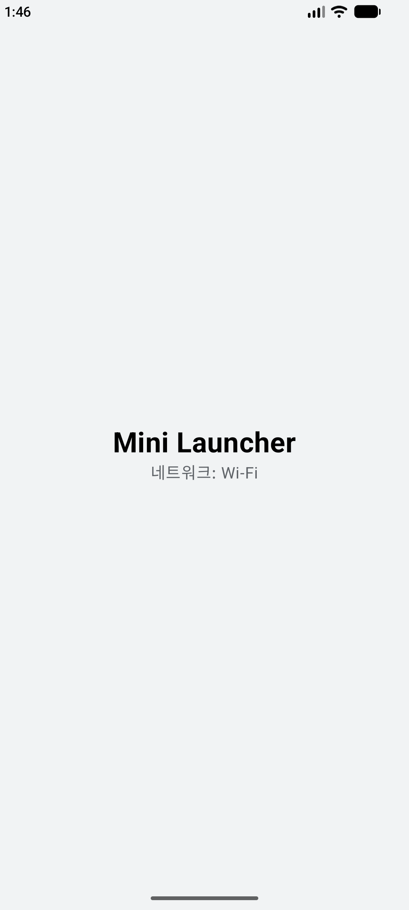

# 1일차 오전: Kotlin 핵심과 프로젝트 구조

모듈 1-1, 1-2 | [전체 일정으로](../README.md)

Kotlin 문법을 12단계 실습으로 실행해 보고, XML 화면 실습을 한 뒤, 앱을 처음 띄워 화면 하나가 뜰 때까지 거치는 파일을 따라갑니다.

## 1-1 Kotlin 핵심 (09:00~10:30)

### Kotlin 문법 실습 12단계

`MainActivity.kt`의 `kotlinPractice(step = 1)`에서 숫자를 1부터 12까지 바꿔 가며 Run 합니다. 결과는 화면이 아니라 Logcat에 찍힙니다. Logcat 검색칸에 `tag:Kotlin`을 넣으면 이 실습이 남긴 줄만 보입니다. 코드는 `practice/KotlinPractice.kt`에 있고, 단계마다 끝에 "바꿔 보기"가 적혀 있습니다.

| 단계 | 실습하는 것 | C++에서 비슷한 것 |
|---|---|---|
| 1 | `val`, `var`, 문자열 안의 `$변수` | const와 변수, auto, printf 서식 |
| 2 | 숫자 계산: 더하기, 나누기, 나머지, 비교 | 같음 |
| 3 | 문자열 다루기: 길이, 대소문자, 들어 있는지 | `std::string`의 멤버 함수 |
| 4 | `if`, `else`, `&&`, `!` | if와 삼항 연산자 |
| 5 | `when`으로 값 고르기 | switch |
| 6 | `for`와 범위 `1..3`, `until`, `downTo` | for 문 |
| 7 | `while`, `break` | 같음 |
| 8 | 함수, 기본 인자, 이름 붙인 인자 | 함수와 기본 인자 |
| 9 | `listOf`, `mutableListOf` | `std::vector`, 범위 기반 for |
| 10 | `App?`, `?.`, `?:` (null 안전) | 포인터와 null 검사 |
| 11 | `filter { }`, `map { }` 람다 | `[](auto& a){ }` 람다 |
| 12 | 종합: 앱 검색 함수 | (3일차 검색 기능의 축소판) |

직접 써 보려면 같은 폴더의 `practice/KotlinPractice_My.kt`의 빈 함수에 옮겨 적고, `MainActivity.kt`에서 `myKotlinPractice(step = 1)`로 바꿔 실행합니다.

### XML 화면 실습 5단계

`practice/XmlPracticeActivity.kt`의 `STEP` 숫자를 1부터 5까지 바꿔 가며 Run 하고, 에뮬레이터의 앱 목록에서 "XML 연습" 아이콘을 누릅니다. 화면 모양은 `res/layout/xml_step1.xml`부터 `xml_step5.xml`까지에 있습니다. `STEP`을 0으로 두면 직접 써 보는 빈 화면 `res/layout/xml_my.xml`이 뜹니다.

1단계를 실행하면 Logcat에 이렇게 찍힙니다.

```
D/Kotlin: ===== 1단계 =====
D/Kotlin: 앱 이름: Mini Launcher
D/Kotlin: 앱 개수: 4
D/Kotlin: 글자 수: 13, 버전: 1.0
```

## 1-2 안드로이드 구조와 프로젝트 구성 (10:30~12:00)

1. 위쪽 기기 목록에서 에뮬레이터를 고르고 초록 삼각형(Run)을 누릅니다. 이 화면이 뜹니다.

    

2. 아래 Logcat 창 검색칸에 `tag:MiniLauncher`를 넣습니다. 앱이 남긴 로그 한 줄이 보입니다.

```
D/MiniLauncher: MainActivity onCreate, 프로세스 id=6318
```

이제 그 화면이 뜰 때까지 거친 파일을 차례로 열어 봅니다.

| 파일 | 하는 일 |
|---|---|
| `app/src/main/AndroidManifest.xml` | 앱의 4대 컴포넌트(Activity, Service, BroadcastReceiver, ContentProvider)를 시스템에 알리는 목록입니다. `MAIN`과 `LAUNCHER`가 있어야 앱 서랍에 아이콘이 생깁니다 |
| `app/build.gradle.kts` | compileSdk, minSdk, 의존성을 적습니다. C++의 CMakeLists 자리입니다 |
| `MainActivity.kt` | `setContent { }` 안이 Compose로 그린 화면입니다 |

## 막히면

- 빌드가 `non-ASCII characters` 오류로 멈춤: 한글이 들어간 경로에 압축을 푼 경우입니다. `C:\Users\Public\minilauncher`로 옮겨서 다시 엽니다.
- Run 버튼이 회색: 위쪽 기기 목록에서 에뮬레이터를 고릅니다.
- 처음 동기화가 오래 걸림: Gradle과 라이브러리를 받는 중입니다. 오른쪽 아래 진행 표시가 끝날 때까지 기다립니다.

다음: [1-3 Jetpack Compose 기초](../day1_step02_compose)
