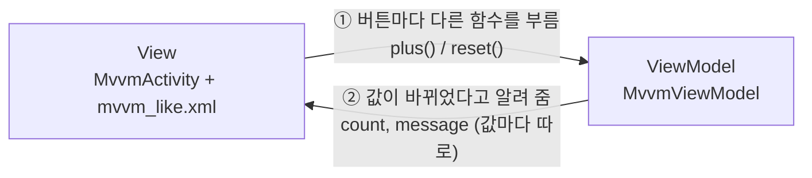
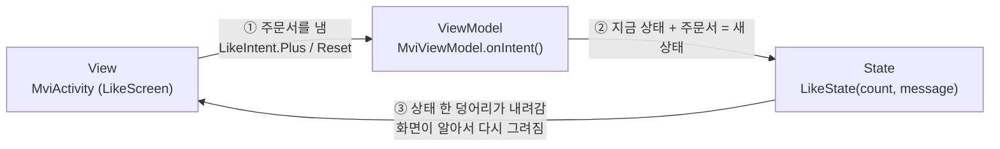

# 비교 코드: MVVM과 MVI

1일차 4교시 끝 | [전체 일정으로](../README.md)

보여 주기용 코드입니다. 같은 "좋아요" 화면을 두 가지 방식으로 만들었고, 코드는 폴더 두 개가 전부입니다.

`day1_step02_02_mvvm_mvi` 폴더를 열고 Run 하면 MVVM 화면이 뜹니다. MVI 화면은 에뮬레이터의 앱 목록에서 "MVI 예제 (Compose)" 아이콘으로 엽니다. Logcat 검색창에는 `tag:Arch`를 넣습니다.

| 폴더 | 화면 | 파일 |
|---|---|---|
| `mvvm` | XML | `MvvmViewModel.kt` (값과 함수), `MvvmActivity.kt` (화면), `res/layout/mvvm_like.xml` (모양) |
| `mvi` | Compose | `LikeState.kt` (상태), `LikeIntent.kt` (주문서), `MviViewModel.kt` (주문서를 받아 새 상태를 만듦), `MviActivity.kt` (화면) |

## 그림으로 보기

화살표는 "누가 누구에게 말하는가"입니다. 두 방식 모두 화면이 ViewModel에 일을 알리고, ViewModel이 값을 바꾸면 화면이 그 값을 보여 줍니다. 한 바퀴 도는 것은 같고, 화살표에 실리는 것이 다릅니다.

### MVVM (`mvvm` 폴더, XML)



1. +1을 누르면 화면이 `vm.plus()`를 부릅니다. 처음으로를 누르면 `vm.reset()`을 부릅니다. 올라가는 길이 버튼 수만큼 있습니다.
2. ViewModel이 `count`와 `message`를 바꿉니다.
3. 화면은 두 값을 각각 지켜보고 있다가(`observe`) 바뀐 값으로 글자를 직접 고칩니다. 내려오는 길도 값 수만큼 있습니다.

### MVI (`mvi` 폴더, Compose)



1. +1을 누르면 화면이 `onIntent(LikeIntent.Plus)`를 부릅니다. 처음으로를 눌러도 같은 `onIntent`에 주문서만 바꿔서 냅니다. 올라가는 길이 하나입니다.
2. ViewModel이 `when`으로 주문서를 보고 새 `LikeState`를 만듭니다.
3. 새 상태가 화면으로 내려가고, Compose가 그 상태로 화면을 다시 그립니다. 내려오는 길도 하나입니다.

### 두 그림의 차이

| | MVVM | MVI |
|---|---|---|
| 화면에서 ViewModel로 올라가는 길 | 버튼 수만큼 (`plus()`, `reset()`) | 하나 (`onIntent`) |
| ViewModel에서 화면으로 내려오는 길 | 값 수만큼 (`count`, `message`) | 하나 (`LikeState`) |
| 도는 방향 | 올라갔다 내려옴 | 한 방향으로 한 바퀴 (화면, 주문서, 상태, 다시 화면) |

화면은 ViewModel을 알지만 ViewModel은 화면을 모릅니다. ViewModel 코드에는 `TextView`도 `Activity`도 나오지 않습니다. 그래서 화면을 XML에서 Compose로 바꿔도 ViewModel은 그대로 쓸 수 있고, 화면 없이 ViewModel만 테스트할 수 있습니다.

## 무엇이 다른가

둘 다 화면은 그리기만 하고, 값을 바꾸는 규칙은 ViewModel에 둡니다. 다른 것은 화면이 ViewModel에 말하는 방법과 상태를 담는 방법입니다.

| | MVVM (`mvvm` 폴더) | MVI (`mvi` 폴더) |
|---|---|---|
| 화면이 ViewModel에 말하는 법 | 할 일마다 함수가 따로 (`plus()`, `reset()`) | 문이 하나 (`onIntent(주문서)`) |
| 상태 | 값마다 따로 (`count`, `message`) | 한 덩어리 (`LikeState`) |
| 값이 바뀌면 | 값마다 지켜보는 줄(`observe`)을 적고 글자를 직접 고침 | 상태를 읽는 화면이 알아서 다시 그려짐 |
| 좋은 점 | 적을 것이 적음. 작은 화면에 충분 | 일어난 일이 한곳에 순서대로 남음. 값을 하나만 바꾸는 실수가 줄어듦 |
| 아쉬운 점 | 버튼이 많아지면 값이 왜 바뀌었는지 찾기 어려움 | 적을 것이 많음. 버튼 하나에 주문서 종류와 `when` 가지를 같이 더함 |
| 비유 | 리모컨. 버튼마다 하는 일이 따로 | 창구가 하나인 은행. 신청서를 한 창구에 냄 |

```kotlin
// MVVM: 할 일마다 함수. 값마다 지켜보는 줄
plusButton.setOnClickListener { vm.plus() }
vm.count.observe(this) { countText.text = "$it" }
vm.message.observe(this) { messageText.text = it }

// MVI: 상태 하나를 받고, 문 하나로 내보냄
LikeScreen(state = vm.state, onIntent = vm::onIntent)
Button(onClick = { onIntent(LikeIntent.Plus) }) { Text("+1") }
```

## 왜 이렇게 나누나

화면에서 계산을 빼기 위해서입니다. 화면은 그리기만 하고 값을 바꾸는 규칙은 ViewModel에 둡니다. 그래야 화면 없이 ViewModel만 테스트할 수 있고, 화면을 돌려도 값이 남습니다.

MVI가 한 걸음 더 가는 이유는 추적입니다. 버튼이 많아지면 "지금 값이 왜 이렇게 됐지?"를 찾기 어려운데, 문이 하나면 그 문에 로그 한 줄만 찍어도 일어난 일이 순서대로 다 보입니다.

## 왜 XML은 MVVM, Compose는 MVI로 짝지었나

XML 화면은 값이 바뀌어도 알아서 바뀌지 않습니다. 그래서 값마다 지켜보다가(`observe`) 글자를 고쳐 주는 줄이 필요하고, 이 방식이 XML 시절에 MVVM으로 굳었습니다. 화면과 값이 서로를 고치는 양방향 바인딩도 이때 많이 썼습니다.

Compose는 값이 한 방향으로만 흐릅니다. 상태가 위에서 아래로 내려가고, 일어난 일이 아래에서 위로 올라옵니다. "상태 하나, 문 하나"인 MVI가 이 흐름과 모양이 같아서 Compose와 잘 맞습니다.

Compose에서 MVVM을 못 쓰는 것은 아닙니다. 3일 동안 만드는 런처는 Compose에 MVVM을 씁니다(`LauncherViewModel`). 다만 Compose식 MVVM은 양방향 바인딩을 쓰지 않아서 모양이 MVI와 비슷해지고, 아예 MVI로 쓰는 팀도 많습니다.
