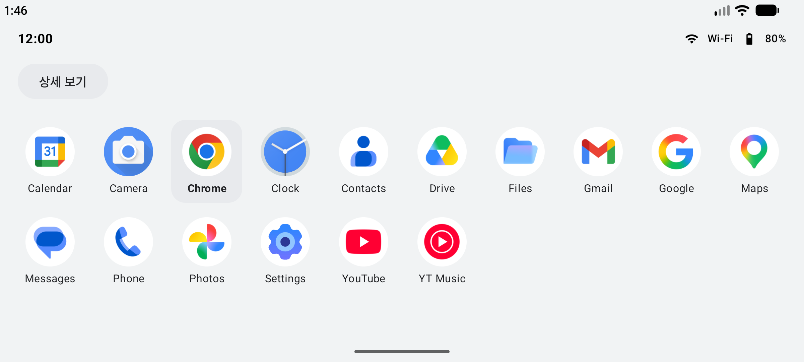
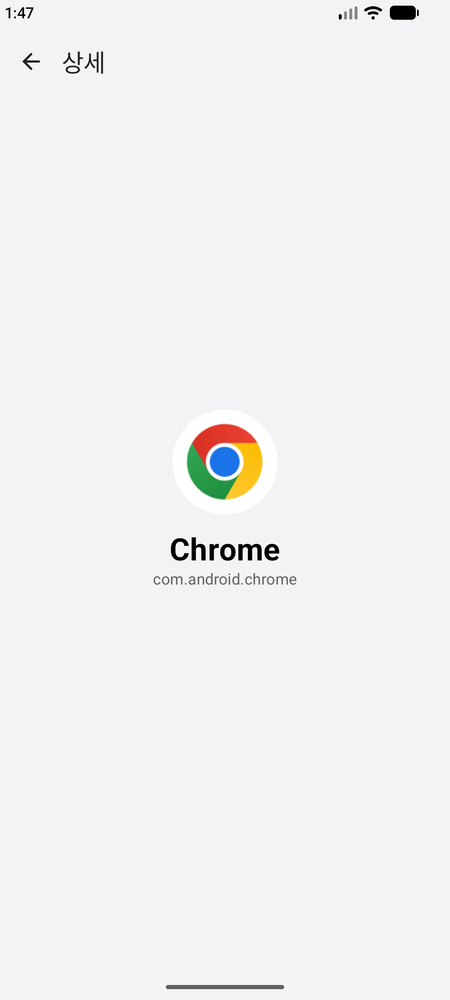

# 1-4 Activity 생명주기와 화면 이동

1일차 15:00~17:00 | [전체 일정으로](../README.md)

`day1_step03_lifecycle` 폴더를 열고 시작합니다.

앞 모듈에서 화면을 돌리면 선택이 사라졌습니다. 왜 그런지 로그와 디버거로 확인합니다. 이 폴더의 코드는 ViewModel로 이미 고쳐 둔 상태라, 돌려도 선택이 남는 차이를 봅니다. 끝에 Intent로 상세 화면도 하나 엽니다.

<p>
</p>

## 따라 하기

### 1. 생명주기 로그 보기

1. 앱을 Run으로 실행합니다.
2. Logcat 검색칸에 `tag:Lifecycle`을 넣습니다.

3. 홈 버튼, 다시 열기, 가로로 돌리기를 해 보며 동작마다 어떤 콜백이 찍히는지 봅니다. 가로로 돌렸다가 다시 세로로 돌리면 이렇게 찍힙니다.

```
D/Lifecycle: onCreate (복원 데이터 없음)
D/Lifecycle: onStart
D/Lifecycle: onResume
D/Lifecycle: LauncherViewModel 생성
D/Lifecycle: onPause
D/Lifecycle: onStop
D/Lifecycle: onDestroy (회전 때문이면 true: true)
D/Lifecycle: onCreate (복원 데이터 있음)
D/Lifecycle: onStart
D/Lifecycle: onResume
D/Lifecycle: onPause
D/Lifecycle: onStop
D/Lifecycle: onDestroy (회전 때문이면 true: true)
D/Lifecycle: onCreate (복원 데이터 있음)
```

`onDestroy` 줄 끝이 `true`인 것은 화면 회전 때문에 없어졌다는 뜻입니다. 그 뒤에 `onCreate`가 다시 찍힙니다. 화면을 돌리면 Activity가 새로 만들어집니다. 1-3(step02)에서 선택이 사라진 이유입니다.

### 2. ViewModel로 선택 유지

`LauncherViewModel.kt`를 엽니다. 선택된 앱을 Activity가 아니라 ViewModel이 들고 있습니다. 화면을 돌려도 선택이 남는지 확인합니다. 로그에 `LauncherViewModel 생성`이 처음 한 번만 찍히는 것도 봅니다.

### 3. Intent로 상세 화면 열기

아이콘을 고르고 상세 보기를 누릅니다. `DetailActivity`가 열리고 앱 이름과 패키지 이름이 보입니다. `MainActivity.kt`에서 `Intent(context, DetailActivity::class.java)`와 `putExtra`를 찾아 보고, `DetailActivity.kt`의 `getStringExtra`가 `putExtra`와 같은 키(`EXTRA_LABEL`, `EXTRA_PACKAGE`)를 쓰는지 봅니다.

## 생명주기는 언제 중요한가

앱은 켜져 있는 동안에도 계속 화면 뒤로 갔다가 돌아옵니다. 앱을 실행해 두고 아래 상황을 차례로 해 보며 Logcat(`tag:Lifecycle`)을 확인합니다.

| 상황 | 찍히는 로그 | 그래서 할 일 |
|---|---|---|
| 홈 버튼으로 나감, 화면을 끔, 다른 앱이 위로 옴 | onPause, onStop | 안 보이는 동안은 화면 갱신과 센서를 멈춥니다. 안 멈추면 배터리가 닳습니다 |
| 다시 돌아옴 | onStart, onResume | 그동안 바뀐 값(시각, 배터리)을 다시 받아 옵니다 |
| 화면을 돌림 | onPause, onStop, onDestroy, onCreate(복원 데이터 있음), onStart, onResume | 화면이 새로 만들어집니다. 남길 값은 ViewModel이나 rememberSaveable에 둡니다 |
| 뒤로 가기로 닫음 | onPause, onStop, onDestroy. 다시 열면 onCreate(복원 데이터 없음) | 사용자가 끝낸 것입니다. 처음 상태로 다시 시작합니다 |
| 뒤에 있는 동안 시스템이 메모리를 비우려고 끝냄 | 로그 없음. 다시 열면 onCreate(복원 데이터 있음)과 LauncherViewModel 생성 | ViewModel의 값은 사라집니다. 작은 값은 rememberSaveable로 돌아오고, 꼭 남길 것은 파일에 저장합니다 |

전화를 받거나 알림을 눌러 다른 화면에 다녀오는 것도 같은 흐름입니다. 쓰던 글자와 보던 위치는 그대로여야 합니다.

## 막히면

- Logcat에 아무것도 안 보임: 위쪽 기기 선택이 지금 쓰는 에뮬레이터인지, 검색칸 글자가 맞는지 봅니다.

## 더 해 보기

선택한 앱 이름을 상태 영역 가운데에 보여 주고, 화면을 돌려도 남는지 확인합니다.

다음: [2-1 메인 스레드와 Coroutine, Flow](../day2_step04_coroutine)
