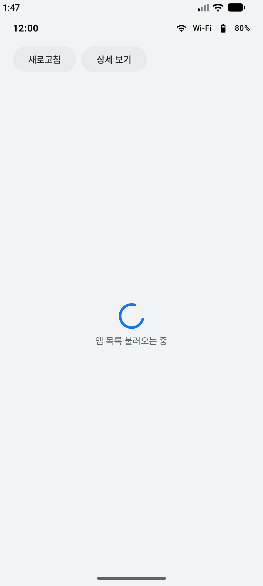
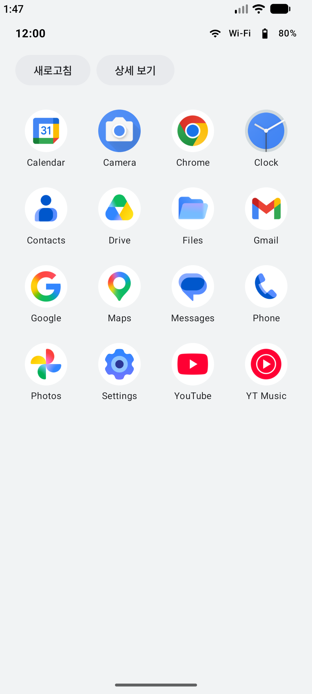
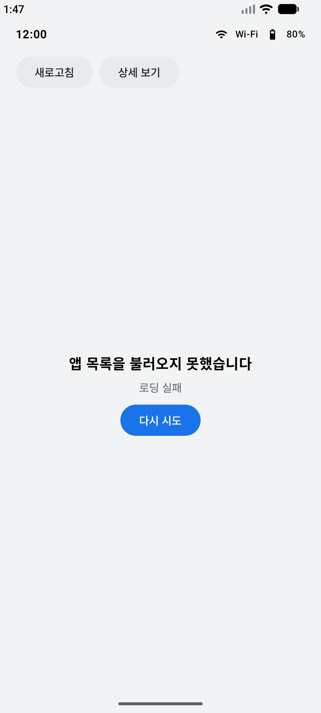

# 2-1 메인 스레드와 Coroutine, Flow

2일차 10:00~12:00 | [전체 일정으로](../README.md)

`day2_step04_coroutine` 폴더를 열고 시작합니다.

2일차 2교시부터 씁니다. 1교시의 스레드 실습은 [day2_step04_thread](../day2_step04_thread) 폴더에 있습니다. 코루틴의 기능을 하나씩 돌려 보고, 앱 목록을 2초 걸려 불러오는 동안의 화면(불러오는 중, 성공, 실패)을 StateFlow 하나로 나타냅니다.

## 코루틴 실습 11단계

`MainActivity.kt`의 `coroutinePractice(lifecycleScope, step = 1)`에서 숫자를 바꿔 가며 Run 합니다. 2교시에 1~7과 11, 3교시에 8~10을 합니다. Logcat 검색칸에 `tag:Coroutine`을 넣습니다. 줄마다 지난 시간(ms)과 스레드 이름이 같이 찍힙니다. 코드는 `practice/CoroutinePractice.kt`에 있고, 단계마다 끝에 바꿔 보면 어떻게 되는지가 적혀 있습니다.

| 단계 | 실습하는 것 |
|---|---|
| 1 | `launch`: 시작만 하고 바로 다음 줄로 갑니다 |
| 2 | `delay`: 스레드를 막지 않아 두 코루틴이 번갈아 돕니다 |
| 3 | `suspend` 함수를 차례로 부릅니다 (0.6초) |
| 4 | `async`, `await`로 동시에 받습니다 (0.3초) |
| 5 | `withContext`: 스레드 이름이 바뀝니다 |
| 6 | `cancel`: 기다리던 delay에서 바로 멈춥니다 |
| 7 | `try`, `catch`로 실패를 잡습니다 |
| 8 | `flow`, `emit`, `collect` |
| 9 | `MutableStateFlow`: 최신 값 하나를 들고 있습니다 |
| 10 | 종합: 불러오는 중, 성공, 실패 |
| 11 | `lifecycleScope`: 화면을 돌리거나 닫으면 코루틴이 같이 취소됩니다 |

직접 써 보려면 `practice/CoroutinePractice_My.kt`의 빈 함수에 옮겨 적고 `myCoroutinePractice`로 바꿔 실행합니다.

## 오전 과제: 복습 퀴즈 앱 만들기

뼈대 프로젝트 [day2_task1_quiz_practice](../day2_task1_quiz_practice)를 열고 복습 퀴즈 앱을 만듭니다. 완성 프로젝트는 [day2_task1_quiz_answer](../day2_task1_quiz_answer)입니다.

## 따라 하기

앱 목록에서 "실험실" 아이콘을 열면 경쟁 상태 실험 버튼 두 개가 있습니다.

### 1. 경쟁 상태(race condition) 만들기

"코루틴 2개가 동시에 +1 (Mutex 없음)"을 누릅니다. 코루틴 두 개가 같은 변수를 100만 번씩 더하는데, 결과가 대부분 200만보다 작습니다(가끔 200만이 나오면 한 번 더 누릅니다). "Mutex 로 고친 버전"은 항상 200만입니다. C++에서 data race를 `std::mutex`로 막는 것과 같은 원리입니다. 코드는 `lab/RaceCounter.kt`에 있습니다.

### 2. StateFlow로 화면 바꾸기

앱 서랍에서 Mini Launcher를 다시 엽니다. 앱 목록을 `FakeAppRepository`에서 받는데, 2초 기다리고 30% 확률로 실패합니다. 새로고침을 몇 번 눌러 세 가지 화면(불러오는 중, 성공, 실패)을 모두 봅니다.

- `LauncherViewModel.kt`: 화면 상태를 `AppsState`(Loading, Error, Success) 하나로 묶어 StateFlow로 내보냅니다.
- `ui/AppsContent.kt`: 화면은 그 상태 하나만 보고 그립니다.

### 3. 테스트

Shift 두 번으로 `CoroutineTest`를 찾아 열고, `class CoroutineTest` 줄 왼쪽 초록 화살표 > Run 'CoroutineTest'로 파일 전체를 실행합니다. 2초 기다림을 가상 시간으로 건너뛰어서 바로 끝납니다.

## 코루틴, 헷갈리는 것 정리

| 질문 | 답 |
|---|---|
| 코루틴은 스레드인가 | 아닙니다. 스레드 위에서 돌다가 `delay`나 `withContext`를 만나면 스레드를 잠시 비켜 주는 작업 단위입니다. 그동안 스레드는 다른 일을 합니다. 그래서 메인 스레드에서 `delay(2000)`은 화면을 멈추지 않고 `Thread.sleep(2000)`은 멈춥니다 |
| suspend는 무엇인가 | 중간에 멈췄다가 이어질 수 있는 함수라는 표시입니다. suspend를 붙인다고 다른 스레드에서 도는 것은 아닙니다 |
| Dispatchers | 어느 스레드에서 돌릴지 고릅니다. Main은 화면, IO는 파일과 네트워크 대기, Default는 계산이 많은 일입니다 |
| scope | 코루틴은 scope에 묶여 있고, scope가 끝나면 같이 취소됩니다. `viewModelScope`는 ViewModel이 사라질 때, `rememberCoroutineScope`는 화면이 사라질 때 끝납니다 |
| Flow와 StateFlow | Flow는 값이 여러 번 흘러나오는 통로입니다. StateFlow는 항상 최신 값 하나를 들고 있어서 화면 상태를 담기에 맞습니다 |
| Mutex | `std::mutex`와 같은 역할입니다. 기다리는 동안 스레드를 막지 않고 코루틴만 멈춥니다 |

더 읽을 거리: [Kotlin coroutines on Android](https://developer.android.com/kotlin/coroutines), [Coroutines basics](https://kotlinlang.org/docs/coroutines-basics.html), [StateFlow and SharedFlow](https://developer.android.com/kotlin/flow/stateflow-and-sharedflow)

다음: [2-2 시스템 이벤트 감지](../day2_step05_receiver)
