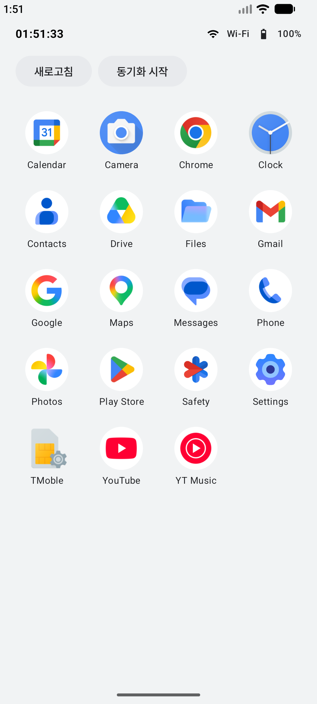
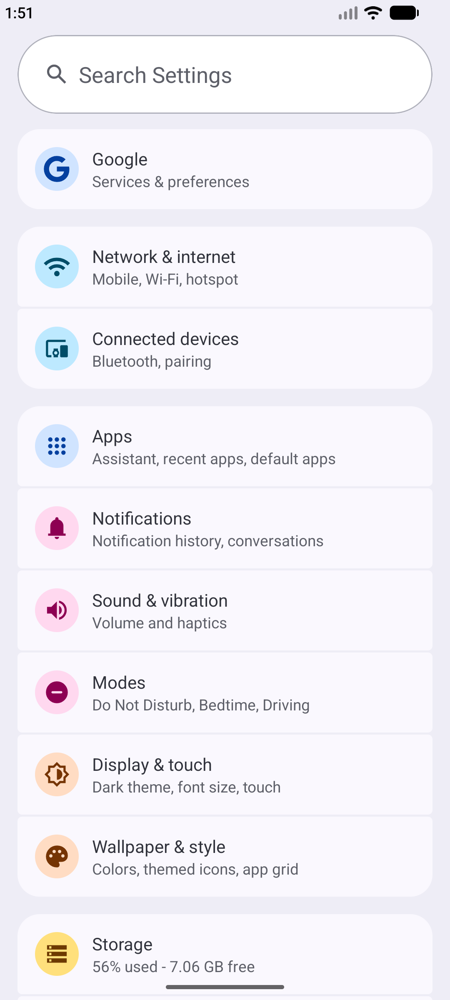
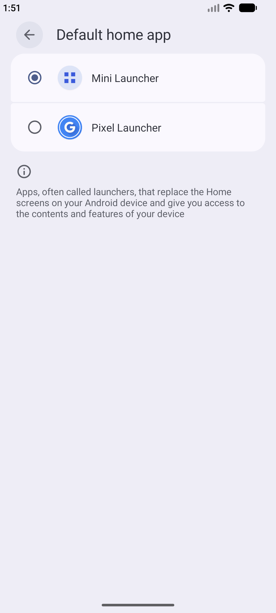
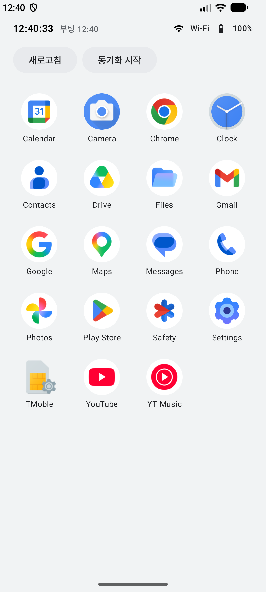
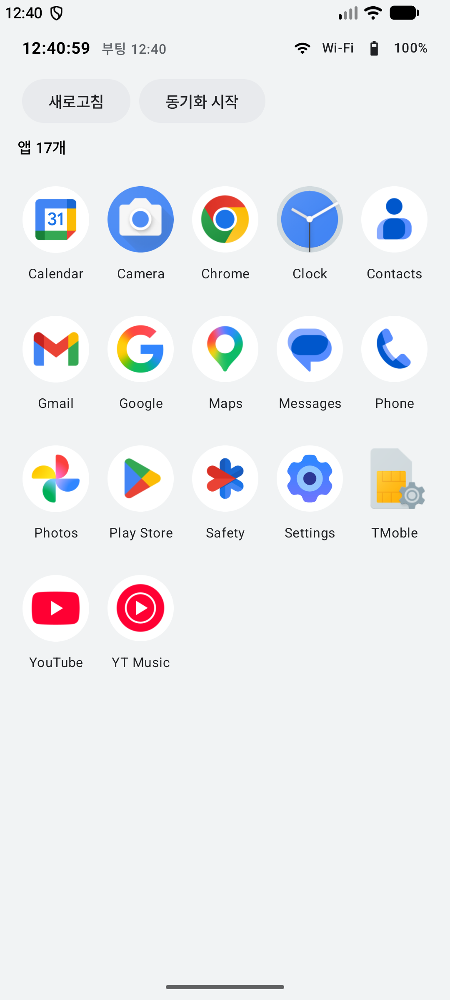
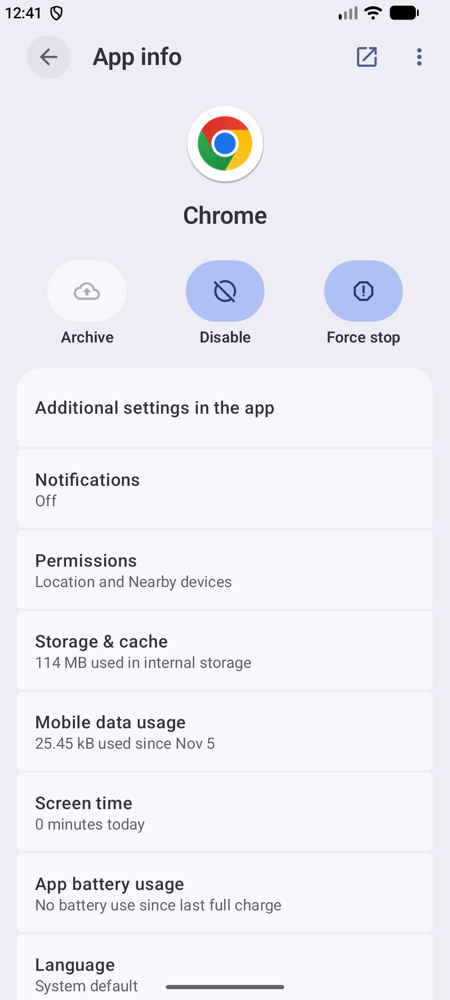

# 3-1 HomeScreen(Launcher) 만들기

3일차 09:00~12:00 | [전체 일정으로](../README.md)

`day3_step07_launcher` 폴더를 열고 시작합니다.

고정 목록을 에뮬레이터에 실제로 설치된 앱으로 바꿉니다. 마지막에는 이 앱을 기본 홈 앱으로 등록해서 홈 버튼에 연결합니다.

<p>

</p>

## 단계별 실습 8단계

`MainActivity.kt`의 `launcherPractice(this, step = 1)`에서 숫자를 1부터 8까지 바꿔 가며 Run 하고 Logcat을 봅니다. 코드는 `practice/LauncherPractice.kt`에 있습니다. 직접 써 보려면 같은 폴더의 `practice/LauncherPractice_My.kt`의 빈 함수에 옮겨 적고, `MainActivity.kt`에서 바로 아래 주석 줄(`my...Practice`)로 바꿔 실행합니다.

## 따라 하기

### 1. 설치된 앱 목록

1. 앱을 실행합니다. 고정 16개가 아니라 에뮬레이터에 실제로 설치된 앱이 모두 나옵니다.
2. `data/InstalledAppRepository.kt`를 엽니다. `PackageManager.queryIntentActivities`로 "앱 서랍에 보일 앱(MAIN + LAUNCHER)"을 묻습니다.
3. `LauncherViewModel.kt`는 2일차와 거의 같습니다. `AppRepository` 인터페이스 덕분에 가짜 목록을 실제 목록으로 바꿔 끼웠습니다.

### 2. `<queries>`를 지워 보기

1. `AndroidManifest.xml`에서 `<queries> ... </queries>` 덩어리를 지우고 다시 실행합니다.
2. 앱이 몇 개만 남습니다. Android 11부터는 다른 앱을 보려면 무엇을 찾을지 Manifest에 미리 적어야 합니다(패키지 공개 범위).
3. 확인했으면 Edit > Undo로 되돌립니다.

### 3. 앱 실행과 상세 화면

- 아이콘을 누르면 그 앱이 열립니다. `AppLauncher.kt`의 `launchApp`은 패키지와 클래스를 지정한 명시적 Intent를 씁니다.
- 아이콘을 길게 누르면 상세 화면에 실제 패키지 이름이 나옵니다.

### 4. 기본 홈 앱으로 등록

1. `AndroidManifest.xml`의 MainActivity에 `HOME`과 `DEFAULT` 카테고리가 있는지 봅니다.
2. 에뮬레이터에서 Settings > Apps > Default apps > Home app을 엽니다.
3. Mini Launcher를 고릅니다.
4. 홈 버튼을 누릅니다. 직접 만든 화면이 뜹니다.

## 막히면

- 홈 앱 목록에 Mini Launcher가 없음: 이 단계 코드(day3_step07_launcher)를 실행했는지 확인합니다. 앞 단계에는 HOME 카테고리가 없습니다.
- 홈 화면에서 뒤로 가기가 안 먹음: 런처가 닫히지 않게 `BackHandler`로 막아 둔 것입니다.

## 오전 과제: 즐겨찾기 서랍 만들기

과제는 따로 떼어 둔 폴더에서 합니다. 뼈대 [day3_task1_favorites_practice](../day3_task1_favorites_practice)를 열고 README를 따라 채웁니다. 완성 프로젝트는 [day3_task1_favorites_answer](../day3_task1_favorites_answer)입니다.

## 4교시: 내 런처 손보기 5단계

3일차 13:00~14:00. 이 폴더를 그대로 열고 한 단계씩 고친 뒤 Run 합니다. 앞 단계를 되돌리지 않고 쌓아 갑니다. 막히면 Edit > Undo로 그 단계만 되돌립니다.

<p>

</p>

### 1. 한 줄에 아이콘 5개로 고정

`ui/AppGrid.kt`의 `columns` 한 줄을 바꿉니다. `Adaptive(88.dp)`는 "한 칸이 88dp보다 작아지지 않게 알아서", `Fixed(5)`는 "화면 폭과 상관없이 5칸"입니다.

```kotlin
columns = GridCells.Fixed(5),   // 원래: GridCells.Adaptive(minSize = 88.dp)
```

### 2. 아이콘 크기 키우기

`ui/AppIcon.kt`의 `AppIcon` 안에서 `AppIconImage(app)`를 찾아 크기를 넘깁니다. 안 넘기면 기본값 56dp를 씁니다.

```kotlin
AppIconImage(app, size = 72.dp)
```

### 3. 보기 싫은 앱 숨기기

`data/InstalledAppRepository.kt`에서 "런처 자신은 빼기" 줄 바로 아래에 한 줄을 더합니다. 앱은 지워지지 않고 목록에서만 빠집니다. 이름은 기기 언어에 따라 바뀝니다(한국어 기기에서는 "파일"). `packageName`으로 거르면 언어와 상관없이 숨겨집니다.

```kotlin
.filter { it.label !in listOf("Files", "Drive") }
```

### 4. 맨 위에 앱 개수 보이기

`ui/AppsContent.kt`의 `Success` 줄을 아래처럼 바꾸고, 맨 위에 `import androidx.compose.foundation.layout.padding`을 더합니다. `Modifier.weight(1f)`는 글자를 그리고 남은 높이를 격자가 다 쓰게 합니다.

```kotlin
is AppsState.Success -> Column(modifier) {
    Text("앱 ${state.apps.size}개", Modifier.padding(horizontal = 16.dp),
        style = MaterialTheme.typography.labelLarge)
    AppGrid(state.apps, selected, onAppClick, Modifier.weight(1f), onAppLongClick)
}
```

### 5. 길게 누르면 시스템 앱 정보 열기

`AppLauncher.kt` 맨 아래에 함수를 더하고(import 두 줄도), `MainActivity.kt`의 `onAppLongClick`에서 `openDetail`을 `openAppInfo`로 바꿉니다. 위 "단계별 실습 8단계"의 6단계(`step06AppInfo`)와 같은 암시적 Intent이고, 내 앱이 아니라 누른 앱의 패키지를 넘깁니다.

```kotlin
import android.net.Uri
import android.provider.Settings

fun openAppInfo(context: Context, app: AppInfo) {
    val uri = Uri.parse("package:${app.packageName}")
    val action = Settings.ACTION_APPLICATION_DETAILS_SETTINGS
    val intent = Intent(action, uri)
        .addFlags(Intent.FLAG_ACTIVITY_NEW_TASK)
    context.startActivity(intent)
}

// MainActivity.kt
onAppLongClick = { app -> openAppInfo(context, app) },
```

`MainActivity.kt`의 주석 "길게 누르면 상세 화면"도 "길게 누르면 앱 정보"로 고쳐 둡니다.

다 했으면 오후 과제로 넘어갑니다. 이 폴더의 변경은 되돌리지 않아도 됩니다(오후 과제는 다른 폴더에서 합니다).

[전체 일정으로](../README.md)

다음: [3-2 오후 과제: 버그 세 개 찾아 고치기](../day3_step07x_bughunt)
