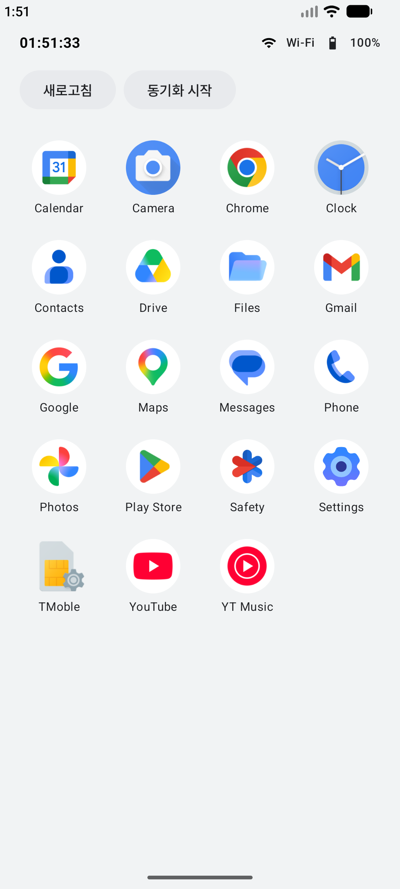

# 3-1 HomeScreen(Launcher) 만들기 (1교시)

3일차 09:00~09:50 | [전체 일정으로](../README.md) | 다음 교시: [day3_step07b_open_home](../day3_step07b_open_home)

1교시 코드만 들어 있습니다: 몸풀기(한 줄로 다른 앱 열기), 설치된 앱 목록 읽기, `<queries>`. 아이콘을 누르면 고른 표시만 바뀝니다. 앱 열기와 홈 앱 등록은 2교시 폴더에서 합니다.

## 몸풀기: 한 줄로 다른 앱 열기

`practice/WarmUp.kt`에 들어 있습니다. `MainActivity.kt`의 `// warmUp(this, step = 1)` 줄에서 `//`를 지우고 숫자를 1부터 4까지 바꿔 가며 Run 합니다. 1은 웹, 2는 지도, 3은 전화 걸기 화면, 4는 보낼 앱을 고르는 창입니다. Logcat 검색칸에 `tag:WarmUp`. 끝나면 그 줄을 다시 `//`로 막습니다.

## 단계별 실습 1~4단계

`MainActivity.kt`의 `launcherPractice(this, step = 1)`에서 숫자를 1부터 4까지 바꿔 가며 Run 하고 Logcat(`tag:LauncherPractice`)을 봅니다. 코드는 `practice/LauncherPractice.kt`에 있습니다. 직접 써 보려면 `practice/LauncherPractice_My.kt`의 빈 함수에 옮겨 적고 `myLauncherPractice(this, step = 1)` 줄로 바꿔 실행합니다.

## 따라 하기

### 1. 설치된 앱 목록

1. 앱을 실행합니다. 에뮬레이터에 실제로 설치된 앱이 모두 나옵니다.
2. `data/InstalledAppRepository.kt`를 엽니다. `PackageManager.queryIntentActivities`로 "앱 서랍에 보일 앱(MAIN + LAUNCHER)"을 묻습니다.
3. `LauncherViewModel.kt`는 목록을 주는 쪽(`AppRepository`)만 알고 있어서, `MainActivity.kt` 한 줄로 고정 목록(`FakeAppRepository`)과 실제 목록을 바꿔 끼울 수 있습니다.

### 2. `<queries>`를 지워 보기

1. `AndroidManifest.xml` 5~10번 줄의 `<queries> ... </queries>`를 `<!--`, `-->`로 감싸 막고 다시 실행합니다.
2. 앱이 몇 개만 남습니다. Android 11부터(targetSdk 30 이상) 다른 앱을 보려면 무엇을 찾을지 Manifest에 미리 적어야 합니다(패키지 공개 범위).
3. 확인했으면 주석을 풀고 다시 Run 합니다.
