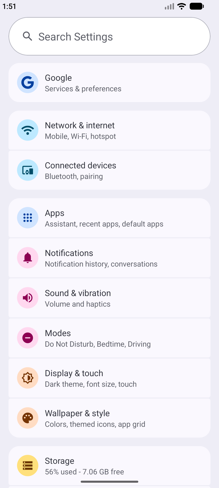
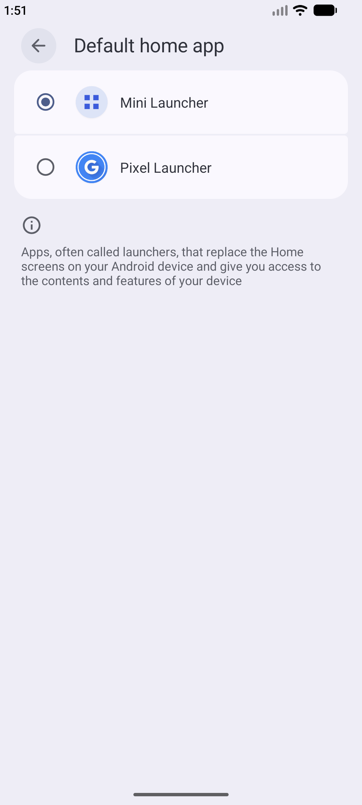

# 3-1 HomeScreen(Launcher) 만들기 (2교시)

3일차 10:00~10:50 | [전체 일정으로](../README.md) | 앞 교시: [day3_step07a_warmup_applist](../day3_step07a_warmup_applist) | 다음: [day3_task1_favorites_practice](../day3_task1_favorites_practice)

2교시 코드만 들어 있습니다: 아이콘을 눌러 다른 앱 열기(명시적 Intent), 길게 눌러 상세 화면, 기본 홈 앱 등록(HOME, DEFAULT, singleTask).

## 단계별 실습 5~8단계

`MainActivity.kt`의 `// launcherPractice(this, step = 5)` 줄에서 `//`를 지우고 숫자를 5부터 8까지 바꿔 가며 Run 합니다. 5와 6은 Run 하면 다른 화면이 열리니, 다 봤으면 그 줄을 다시 `//`로 막습니다. Logcat 검색칸에 `tag:LauncherPractice`.

## 따라 하기

### 3. 앱 실행과 상세 화면

- 짧게 누르면 그 앱이 열립니다. `AppLauncher.kt`의 `launchApp`은 패키지와 화면 이름을 콕 집은 명시적 Intent를 씁니다.
- 길게 누르면 상세 화면(`DetailActivity`)에 그 앱의 패키지 이름이 나옵니다.

### 4. 기본 홈 앱으로 등록

1. `AndroidManifest.xml`의 MainActivity에 `HOME`과 `DEFAULT` 카테고리가 적혀 있는지 봅니다(이미 들어 있음).
2. 에뮬레이터에서 Settings > Apps > Default apps > Home app을 엽니다.
3. Mini Launcher를 고르고 Change를 누릅니다.
4. 홈 버튼을 누릅니다. 직접 만든 화면이 뜹니다.
5. 끝나면 Home app에서 Pixel Launcher로 되돌립니다.

## 막히면

- 홈 앱 목록에 Mini Launcher가 없음: 이 폴더(2교시)를 Run 했는지 확인합니다. 1교시 폴더에는 HOME 카테고리가 없습니다.
- 홈 화면에서 뒤로 가기가 안 먹음: 런처가 닫히지 않게 `BackHandler`로 막아 둔 것입니다.
