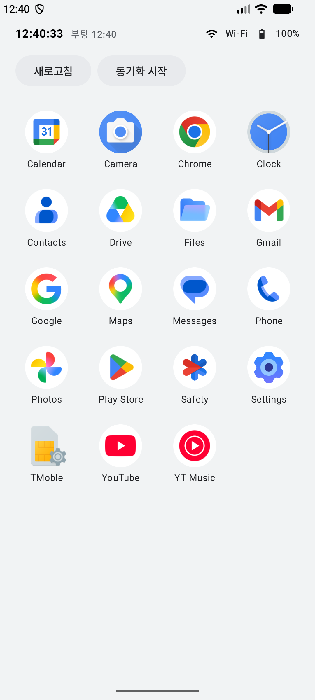
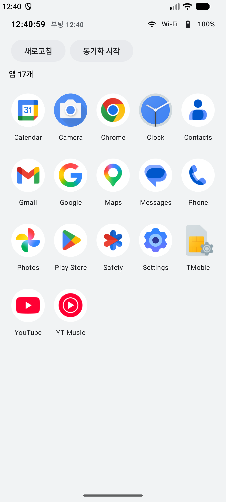
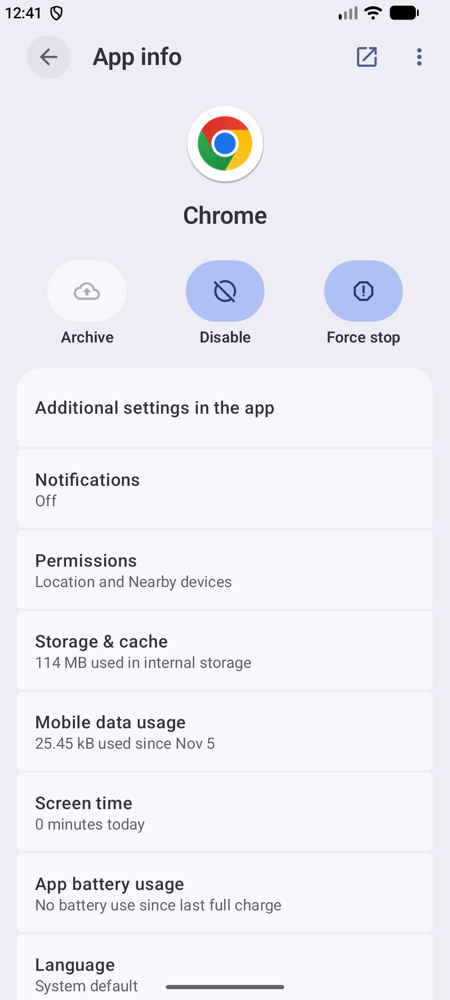

# 3-2 런처 손보기 (4교시)

3일차 13:00~13:50 | [전체 일정으로](../README.md) | 다음: [day3_task2_widget_practice](../day3_task2_widget_practice)

2교시 런처에서 연습 코드를 뺀 시작본입니다. 한 단계씩 고친 뒤 Run 합니다. 앞 단계를 되돌리지 않고 쌓아 갑니다. 막히면 Edit > Undo로 그 단계만 되돌립니다.

<p>

</p>

### 1. 한 줄에 아이콘 5개로 고정

`ui/AppGrid.kt`의 `columns` 한 줄을 바꿉니다. `Adaptive(88.dp)`는 "한 칸이 88dp보다 작아지지 않게 알아서", `Fixed(5)`는 "화면 폭과 상관없이 5칸"입니다.

```kotlin
columns = GridCells.Fixed(5),   // 원래: GridCells.Adaptive(minSize = 88.dp)
```

### 2. 아이콘 크기 키우기

`ui/AppIcon.kt`의 `AppIcon` 안에서 `AppIconImage(app)`를 찾아 크기를 넘깁니다. 안 넘기면 기본값 56dp를 씁니다.

```kotlin
AppIconImage(app, size = 72.dp)
```

### 3. 보기 싫은 앱 숨기기

`data/InstalledAppRepository.kt`에서 "런처 자신은 빼기" 줄 바로 아래에 한 줄을 더합니다. 앱은 지워지지 않고 목록에서만 빠집니다. 이름은 기기 언어에 따라 바뀝니다(한국어 기기에서는 "파일"). `packageName`으로 거르면 언어와 상관없이 숨겨집니다.

```kotlin
.filter { it.label !in listOf("Files", "Drive") }
```

### 4. 맨 위에 앱 개수 보이기

`ui/AppsContent.kt`의 `Success` 줄을 아래처럼 바꾸고, 맨 위에 `import androidx.compose.foundation.layout.padding`을 더합니다. `Modifier.weight(1f)`는 글자를 그리고 남은 높이를 격자가 다 쓰게 합니다.

```kotlin
is AppsState.Success -> Column(modifier) {
    Text("앱 ${state.apps.size}개", Modifier.padding(horizontal = 16.dp),
        style = MaterialTheme.typography.labelLarge)
    AppGrid(state.apps, selected, onAppClick, Modifier.weight(1f), onAppLongClick)
}
```

### 5. 길게 누르면 시스템 앱 정보 열기

`AppLauncher.kt` 맨 아래에 함수를 더하고(import 두 줄도), `MainActivity.kt`의 `onAppLongClick`에서 `openDetail`을 `openAppInfo`로 바꿉니다. 2교시 런처 6단계(`step06AppInfo`)와 같은 암시적 Intent이고, 내 앱이 아니라 누른 앱의 패키지를 넘깁니다.

```kotlin
import android.net.Uri
import android.provider.Settings

fun openAppInfo(context: Context, app: AppInfo) {
    val uri = Uri.parse("package:${app.packageName}")
    val action = Settings.ACTION_APPLICATION_DETAILS_SETTINGS
    val intent = Intent(action, uri)
        .addFlags(Intent.FLAG_ACTIVITY_NEW_TASK)
    context.startActivity(intent)
}

// MainActivity.kt
onAppLongClick = { app -> openAppInfo(context, app) },
```

`MainActivity.kt`의 주석 "길게 누르면 상세 화면"도 "길게 누르면 앱 정보"로 고쳐 둡니다.

### 6. 홈 앱이면 초록 테두리

`ui/HomeFrame.kt`는 이미 들어 있습니다(읽기만). `MainActivity.kt` 세 군데를 고칩니다.

```kotlin
// 1) class 안 맨 위에 한 줄
private var isHome by mutableStateOf(false)

// 2) setContent 안: LauncherScreen 을 HomeFrame 으로 감쌈
HomeFrame(isHome) { LauncherScreen(viewModel(factory = factory)) }

// 3) 이미 있는 onResume 한 줄(44번째 줄쯤)을 바꿔 씀
override fun onResume() {
    super.onResume()
    isHome = isMyAppDefaultHome(this)
    Log.d(TAG, "onResume, 홈 앱인가: $isHome")
}
```

빨간 글자(`mutableStateOf`, `by`, `HomeFrame`, `isMyAppDefaultHome`)는 Alt+Enter로 import 합니다. Home app을 Mini Launcher로 바꾸면 초록 테두리가 생기고, 확인했으면 Pixel Launcher로 되돌립니다(5교시 위젯은 Pixel Launcher 화면에 붙임).
