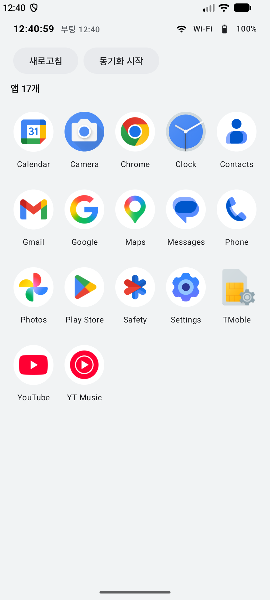
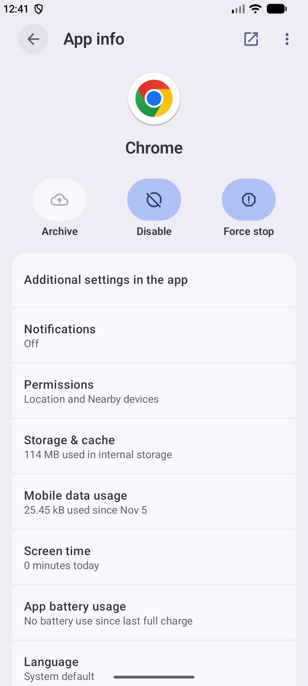

# 3-2 런처 손보기 완성본 (4교시)

3일차 4교시 | [전체 일정으로](../README.md) | 시작본: [day3_step07c_tune](../day3_step07c_tune) | 다음: [day3_task2_widget_answer](../day3_task2_widget_answer)

`day3_step07c_tune`에 손보기 6단계를 모두 적용한 완성본입니다. 바뀐 곳은 코드에 `[1]`~`[6]` 주석으로 표시했습니다. 시작본과 나란히 열어 비교해 보세요.

| 단계 | 바뀐 것 | 파일 |
|---|---|---|
| 1 | 한 줄에 아이콘 5개 (`GridCells.Fixed(5)`) | `ui/AppGrid.kt` |
| 2 | 아이콘 72dp | `ui/AppIcon.kt` |
| 3 | Files, Drive 숨기기 (`filter`) | `data/InstalledAppRepository.kt` |
| 4 | 맨 위에 "앱 N개" | `ui/AppsContent.kt` |
| 5 | 길게 누르면 설정 앱의 앱 정보 (`openAppInfo`) | `AppLauncher.kt`, `MainActivity.kt` |
| 6 | 홈 앱이면 초록 테두리 (`HomeFrame`) | `MainActivity.kt` |

