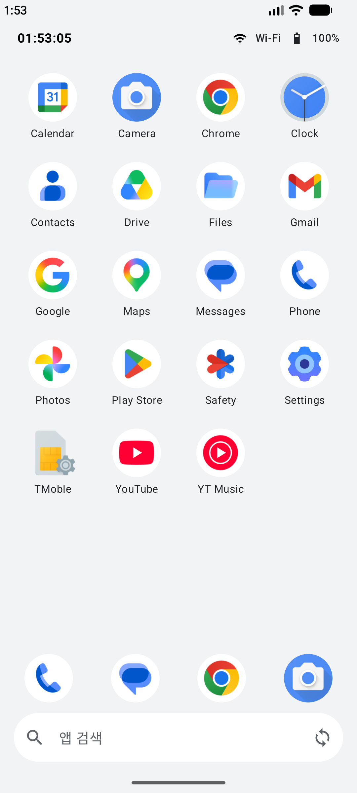
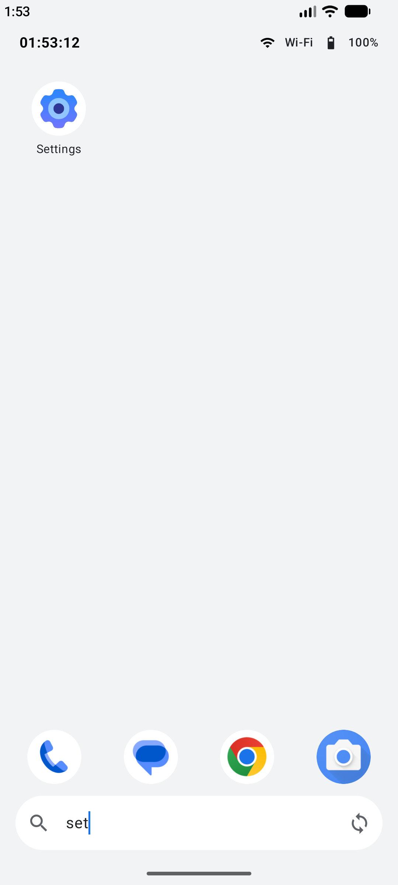
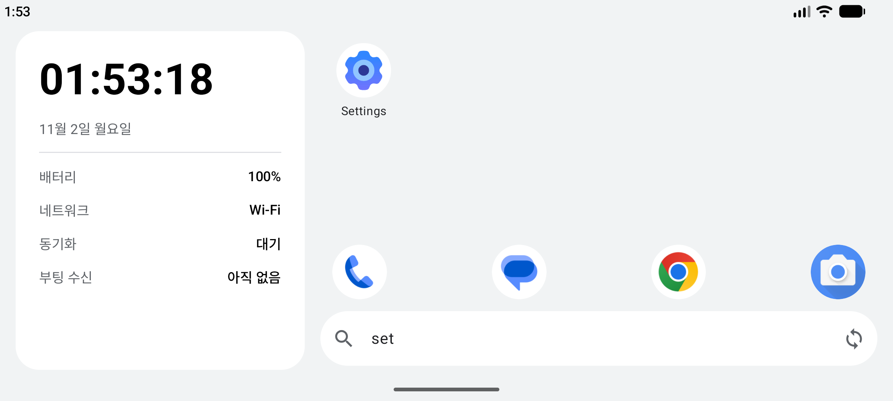

# 3-3 미니 런처 완성과 코드 리뷰

3일차 15:00~17:00 | [전체 일정으로](../README.md)

`day3_step08_final` 폴더를 열고 시작합니다.

검색, 아래 고정 줄, 가로 화면을 더해 미니 런처를 완성합니다. 마지막으로 3일 동안 만든 상태가 각각 어디에 있는지 정리합니다.

<p>
</p>



## 따라 하기

1. 앱을 실행하고 홈 버튼을 누릅니다(3-1에서 기본 홈 앱으로 등록했다면 바로 이 화면이 뜹니다).
2. 맨 아래 검색창에 `set`을 넣습니다. Settings만 남습니다. 에뮬레이터를 돌려도 검색어가 남습니다.
3. 아래 고정 줄(Phone, Messages, Chrome, Camera)의 아이콘을 눌러 앱을 엽니다.
4. 동기화는 검색창 오른쪽 동그란 화살표 아이콘으로 시작합니다.
5. 가로로 돌립니다. 왼쪽에 시계, 배터리, 네트워크, 동기화, 부팅 수신을 모은 정보 패널이 생깁니다. 태블릿처럼 넓은 화면을 나눠 쓰는 연습입니다.

## 코드에서 볼 곳

| 파일 | 볼 점 |
|---|---|
| `MainActivity.kt` | 검색어는 `LauncherViewModel`이 들고 있어서 화면을 돌려도 남습니다. 가로, 세로에 따라 배치를 나눕니다 |
| `model/AppFilter.kt` | 검색과 아래 고정 줄을 고르는 함수입니다. 화면과 떨어져 있어서 `AppFilterTest`로 테스트합니다 |
| `ui/Dock.kt`, `ui/SearchField.kt`, `ui/InfoPanel.kt` | 새로 더한 화면 조각입니다 |

## 코드 리뷰: 상태는 어디에 있나

3일 동안 화면에 보인 값이 각각 어디에 저장되는지 정리하면 이렇습니다.

| 화면에 보이는 값 | 들고 있는 곳 | 화면을 돌리면 | 앱을 닫으면 |
|---|---|---|---|
| 선택한 앱 | `LauncherViewModel`의 StateFlow | 남음 | 사라짐 |
| 검색어 | `LauncherViewModel` | 남음 | 사라짐 |
| 앱 목록 | `LauncherViewModel` (처음 한 번 불러옴) | 남음 | 다시 불러옴 |
| 배터리, 네트워크 | 화면이 있는 동안 등록한 Receiver와 콜백 | 다시 등록 | 해제 |
| 동기화 진행률 | `SyncService`의 StateFlow | 남음 | Service가 끝날 때까지 남음 |
| 부팅 시각 | SharedPreferences (`BootReceiver`가 저장) | 남음 | 남음 |

직접 고친 코드가 있으면, 고친 값이 위 표의 어느 줄에 해당하는지, 화면을 돌렸을 때 표대로 남는지 에뮬레이터에서 확인합니다.

## 같이 만들기: 앱 찾기 (7교시)

글자를 넣으면 이름에 그 글자가 든 앱만 남고, 누르면 그 앱이 열리는 앱입니다. 완성본의 검색창이 하는 일을 화면 하나로 줄인 것입니다.

기본 홈 앱을 원래 런처로 되돌린 뒤 Run 하고, 에뮬레이터의 앱 목록에서 "앱 찾기 직접" 아이콘을 엽니다. 채우는 곳은 `practice/SearchApps_My.kt` 하나이고, 파일 안에 `[1] 여기를 고칩니다`처럼 자리가 표시되어 있습니다. 위에서부터 [1], [2], [3] 순서입니다.

화면에서 쓰는 값 두 개가 파일 위쪽에 있습니다.
- `apps`: 설치된 앱 전체 목록 (화면이 뜰 때 읽어 둠)
- `query`: 검색어. 처음에는 빈 글자

### [1] 검색어가 든 앱만 남기기

**하는 일**: 지금은 `shown`(화면에 보일 앱)이 `apps` 전체입니다. 이름(`label`)에 `query`가 든 앱만 남게 바꿉니다.

**채울 곳**: `val shown = apps` 줄(`[1] 여기를 고칩니다`)의 `apps` 뒤를 고칩니다.

```kotlin
val shown = apps.filter { ______________ }   // 남길 앱이면 true
```

**힌트**
- `filter { }` 안에서 `it`은 앱 하나입니다. 앱 이름은 `it.label`입니다.
- 글자가 들어 있는지는 `contains(찾을 글자, ignoreCase = true)`로 물어봅니다. `ignoreCase = true`는 대소문자를 가리지 않는다는 뜻입니다.

**확인**: 아직 입력창이 없어서 화면은 그대로입니다. 빨간 줄 없이 Run 되면 됩니다. 검색어가 비어 있으면 모든 이름이 빈 글자를 포함하므로 전부 남습니다.

### [2] 검색어 입력창 넣기

**하는 일**: 글자를 넣는 입력창을 넣고, 넣은 글자가 `query`에 들어가게 합니다.

**채울 곳**: 제목 `Text("앱 찾기", ...)` 아래의 `[2] 여기를 채웁니다` 자리.

```kotlin
OutlinedTextField(
    value = ______________,              // ① 입력창에 보여 줄 글자
    onValueChange = { ______________ },  // ② 글자가 바뀌면 할 일
    label = { Text("앱 이름") },
    singleLine = true,                   // 한 줄로
    modifier = Modifier.fillMaxWidth(),  // 가로로 꽉 차게
)
```

**힌트**
- Compose의 입력창은 글자를 스스로 기억하지 않습니다. ①에는 검색어를 담아 둔 변수를 넘깁니다.
- ②의 `{ }` 안에서 `it`이 새로 입력된 글자입니다. `vm.search(it)`으로 ViewModel에 알려야 화면의 글자와 [1]의 목록이 바뀝니다.

**확인**: 입력창에 `c`를 넣으면 Camera, Chrome처럼 c가 든 앱만 남고 개수가 줄어듭니다.

### [3] 누르면 그 앱 열기

**하는 일**: 목록의 줄을 누르면 그 앱을 엽니다.

**채울 곳**: `Row`의 `modifier` 줄(`[3] 여기를 고칩니다`).

```kotlin
modifier = Modifier.fillMaxWidth().clickable { ______________ }.padding(vertical = 6.dp),
```

**힌트**: 앱을 여는 함수는 오늘 2교시에 본 `launchApp`입니다. 무엇을 넘기는지는 `AppLauncher.kt`에서 확인합니다. 이 줄이 그리는 앱은 `items { app -> }`의 `app`입니다.

**확인**: 줄을 누르면 그 앱이 열립니다.

막히면 같은 폴더의 `practice/SearchApps.kt`(완성본, 앱 목록의 "앱 찾기" 아이콘)를 봅니다. 같은 번호가 같은 자리에 있습니다. 뼈대와 완성본이 한 프로젝트에 같이 있어서, 뼈대 쪽 파일과 화면 이름에만 `My`가 붙어 있습니다.

### 단계별 정답

[1] 이름에 검색어가 든 앱만 남깁니다. 검색어가 비어 있으면 모든 이름이 빈 글자를 포함하므로 전부 남습니다.

```kotlin
val shown = apps.filter { it.label.contains(query, ignoreCase = true) }
```

[2] 입력창은 `query`를 보여 주고, 글자가 바뀌면 `vm.search(it)`로 ViewModel의 검색어를 바꿉니다. `query`가 바뀌면 화면이 다시 그려지면서 [1]의 `shown`도 다시 계산됩니다.

```kotlin
OutlinedTextField(
    value = query,
    onValueChange = { vm.search(it) },
    label = { Text("앱 이름") },
    singleLine = true,
    modifier = Modifier.fillMaxWidth(),
)
```

[3] 줄 전체에 `clickable`을 붙여, 누르면 그 줄의 앱을 엽니다.

```kotlin
modifier = Modifier.fillMaxWidth().clickable { launchApp(context, app) }.padding(vertical = 6.dp),
```

## 수업이 끝나면

1. Settings > Apps > Default apps > Home app에서 Pixel Launcher로 되돌립니다.
2. 에뮬레이터에서 Mini Launcher를 지웁니다.

[전체 일정으로](../README.md)
