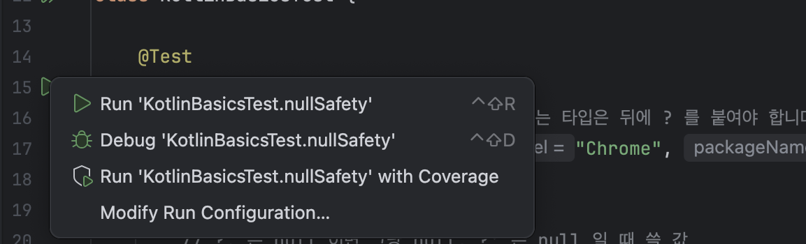
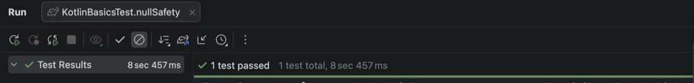
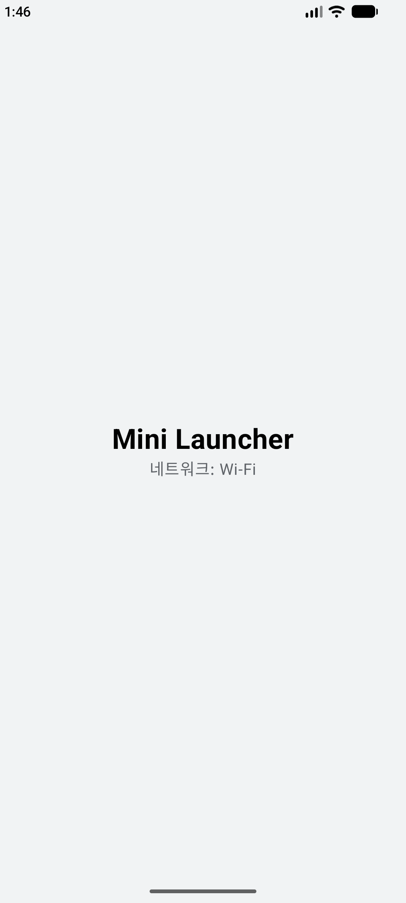

# 1일차 오전: Kotlin 핵심과 프로젝트 구조

모듈 1-1, 1-2 | [전체 일정으로](../README.md)

Kotlin 문법 세 가지를 테스트 코드로 실행해 보고, 앱을 처음 띄운 뒤 화면 하나가 뜰 때까지 거치는 파일을 따라갑니다.

## 1-1 Kotlin 핵심 (09:00~10:30)

Kotlin을 연습하려고 프로젝트를 따로 만들지 않습니다. 테스트 파일의 함수를 하나씩 실행합니다.

1. `step01_project` 폴더를 엽니다. 오른쪽 아래 진행 표시가 사라져야 코드 옆에 초록 화살표가 생깁니다.
2. `app/src/test/java/com/example/minilauncher/KotlinBasicsTest.kt`를 엽니다.
3. `nullSafety` 함수 왼쪽의 초록 화살표를 누르고 Run 'KotlinBasicsTest.nullSafety'를 고릅니다.

    

4. 아래 Run 창에 `1 test passed`가 나오면 성공입니다.

    

5. `lambda`, `dataClass`도 같은 방법으로 실행합니다.

C++와 비교하며 볼 곳은 세 군데입니다.

| Kotlin | C++에서 비슷한 것 | 볼 점 |
|---|---|---|
| `App?`, `?.`, `?:` | 포인터와 null 검사 | null이 될 수 있는 타입은 뒤에 `?`를 붙이고, 컴파일러가 검사를 강제합니다 |
| `filter { }`, `map { }` | `[](auto& a){ }` 람다 | 마지막 인자가 람다면 괄호 밖으로 뺍니다 |
| `data class` | `struct` + `operator==` | equals, toString, copy를 컴파일러가 만들어 줍니다 |

```kotlin
val found: App? = apps.find { it.label == "Maps" }   // 없으면 null
val name = found?.label ?: "없음"                      // null 이면 "없음"
val labels = apps.filter { it.label.startsWith("C") }.map { it.label }
// it 은 인자가 하나인 람다에서 그 인자를 부르는 기본 이름입니다
```

더 해 보기: `assertEquals`의 기대값을 일부러 틀리게 바꾸고 실행해서, 실패했을 때 나오는 메시지를 읽어 봅니다.

## 1-2 안드로이드 구조와 프로젝트 구성 (10:30~12:00)

1. 위쪽 기기 목록에서 에뮬레이터를 고르고 초록 삼각형(Run)을 누릅니다. 이 화면이 뜹니다.

    

2. 아래 Logcat 창 검색칸에 `tag:MiniLauncher`를 넣습니다. 앱이 남긴 로그 한 줄이 보입니다.

```
D/MiniLauncher: MainActivity onCreate, 프로세스 id=5961
```

이제 그 화면이 뜰 때까지 거친 파일을 차례로 열어 봅니다.

| 파일 | 하는 일 |
|---|---|
| `app/src/main/AndroidManifest.xml` | 앱의 4대 컴포넌트(Activity, Service, BroadcastReceiver, ContentProvider)를 시스템에 알리는 목록입니다. `MAIN`과 `LAUNCHER`가 있어야 앱 서랍에 아이콘이 생깁니다 |
| `app/build.gradle.kts` | compileSdk, minSdk, 의존성을 적습니다. C++의 CMakeLists 자리입니다 |
| `MainActivity.kt` | `setContent { }` 안이 Compose로 그린 화면입니다 |

## 막히면

- 빌드가 `non-ASCII characters` 오류로 멈춤: 한글이 들어간 경로에 압축을 푼 경우입니다. `C:\Users\Public\minilauncher`로 옮겨서 다시 엽니다.
- Run 버튼이 회색: 위쪽 기기 목록에서 에뮬레이터를 고릅니다.
- 처음 동기화가 오래 걸림: Gradle과 라이브러리를 받는 중입니다. 오른쪽 아래 진행 표시가 끝날 때까지 기다립니다.

다음: [1-3 Jetpack Compose 기초](../step02_compose)
