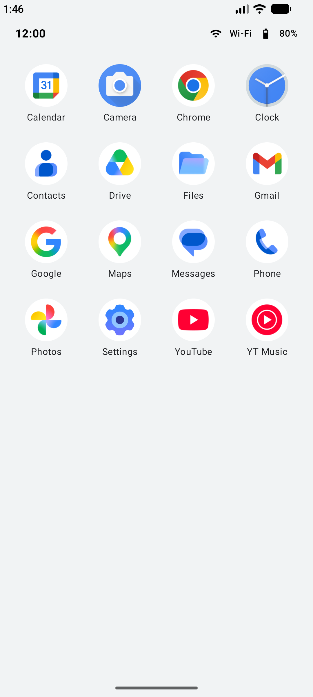
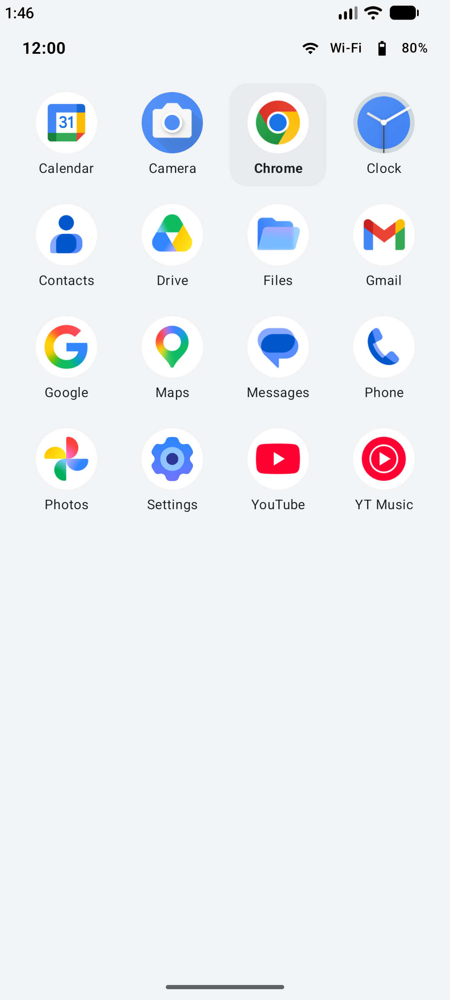
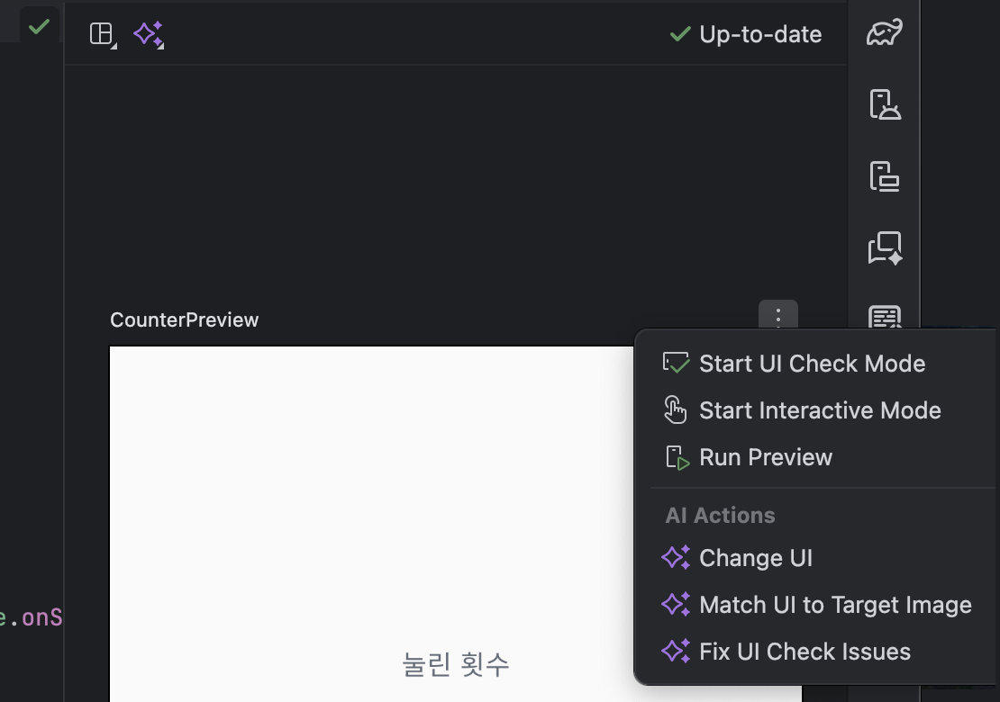
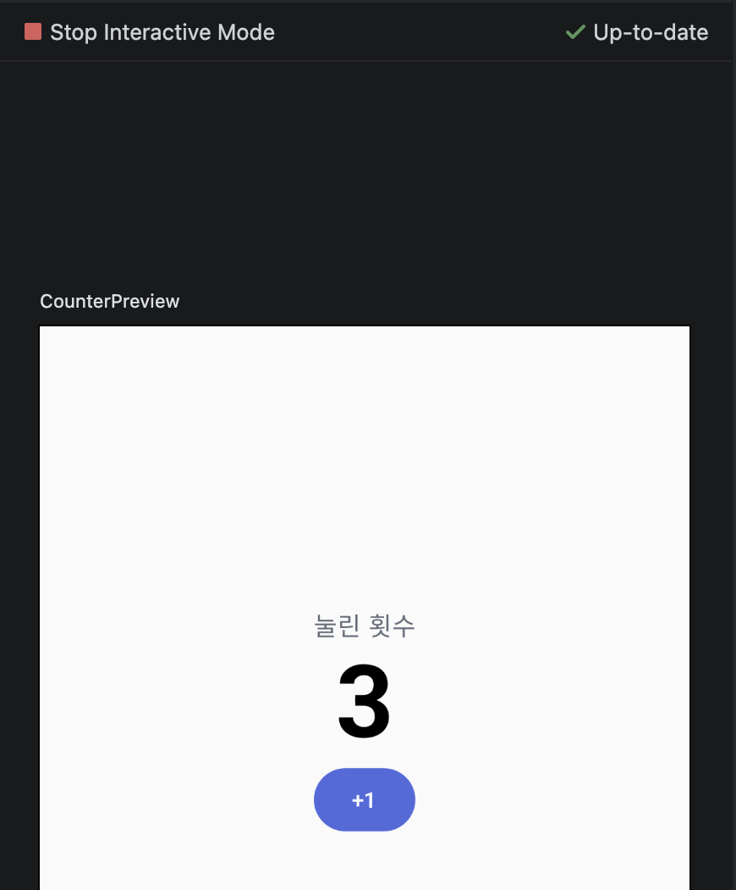
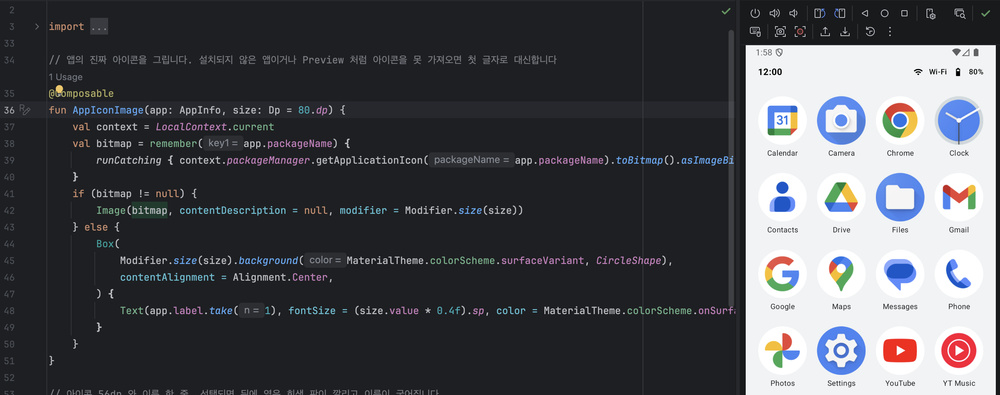
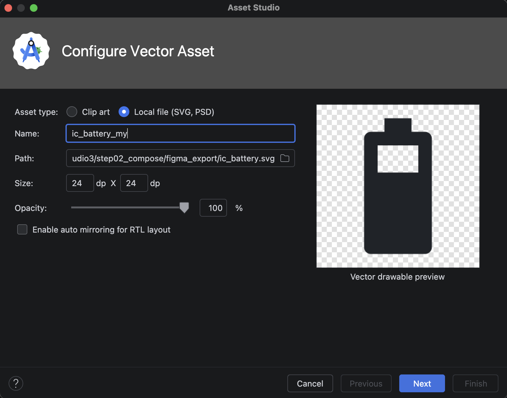
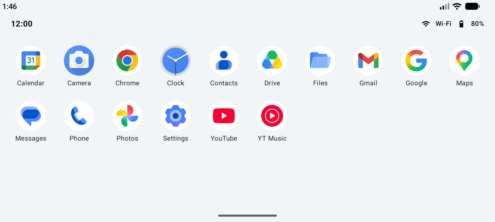

# 1-3 Jetpack Compose 기초

1일차 13:00~15:00 | [전체 일정으로](../README.md)

`step02_compose` 폴더를 열고 시작합니다.

상태가 바뀌면 화면이 다시 그려지는 Compose의 기본을 익히고, 앱 아이콘 16개를 격자로 보여 주는 첫 런처 화면을 만듭니다. Figma에 있는 아이콘을 앱으로 가져오는 것까지 해 봅니다.

## 따라 하기

### 1. Preview에서 카운터 눌러 보기

1. `practice/ComposeBasics.kt`를 엽니다.
2. 오른쪽 위 Split을 눌러 Preview 칸을 엽니다. "A successful build is needed"가 보이면 Build & Refresh를 한 번 누릅니다.
3. Preview 이름(CounterPreview) 오른쪽 ⋮를 누르고 Start Interactive Mode를 고릅니다.

    

4. Preview 안의 +1을 세 번 누릅니다. 숫자가 3이 되면 성공입니다.

    

`@Composable`이 붙은 함수가 화면 조각입니다. `remember { mutableStateOf() }`로 만든 값이 바뀌면 이 함수가 다시 실행되면서 화면이 바뀝니다. 이것을 Recomposition이라고 합니다.

### 2. 런처 화면 코드 읽기

| 파일 | 볼 점 |
|---|---|
| `ui/AppIcon.kt` | 아이콘 56dp와 이름 한 줄. 아이콘은 에뮬레이터에 깔린 진짜 앱 아이콘을 가져오고, 못 가져오면 첫 글자로 대신합니다 |
| `ui/AppGrid.kt` | `LazyVerticalGrid`로 격자를 그립니다. 칸 너비 기준(88dp)이라 가로로 돌리면 열 수가 저절로 늘어납니다 |
| `MainActivity.kt` | 선택된 앱을 `LauncherScreen` 한 곳에서만 기억하고 아래로 내려 줍니다(상태 끌어올리기) |
| `AndroidManifest.xml` | `<queries>`에 고정 앱 16개의 패키지 이름이 있습니다. 다른 앱의 아이콘을 읽으려면 필요합니다(3일차에 자세히) |

dp는 화면 밀도와 상관없이 같은 크기로 보이게 하는 단위입니다. 글자는 sp를 씁니다.

앱을 Run으로 실행하고 아이콘을 하나 눌러 봅니다. 뒤에 회색 판이 깔리고 이름이 굵어집니다.

### 3. Live Edit으로 바로 바꿔 보기

1. 앱을 Run(초록 삼각형)으로 실행한 상태에서 `ui/AppIcon.kt`를 엽니다.
2. `fun AppIconImage(app: AppInfo, size: Dp = 56.dp)`의 `56`을 `80`으로 바꿉니다.
3. 다시 빌드하지 않아도 몇 초 안에 에뮬레이터의 아이콘이 커집니다. 바뀌지 않으면 Settings > Editor > Live Edit에서 Push Edits Automatically를 켭니다. 확인했으면 56으로 되돌립니다.

Debug(벌레 모양)로 실행하면 편집기 위에 Live Edit Unsupported가 뜨고 동작하지 않습니다. Run으로 실행합니다.

### 4. Figma 아이콘을 앱으로 가져오기 (10~15분)

1. [Figma 실습 화면](https://www.figma.com/design/szFZ4g6y6kvu9kJf8WORY0/)의 1일차 페이지에서 "앱 그리드" 화면을 엽니다.
2. 왼쪽 Layers에서 StatusArea > battery > `Icon / battery_5_bar`를 고릅니다.
3. 오른쪽 아래 Export 옆 +를 누르고 형식을 SVG로 바꾼 뒤 Export를 누릅니다. Figma에 로그인할 수 없으면 `step02_compose/figma_export/ic_battery.svg`를 씁니다.
4. Android Studio에서 `app > res`를 오른쪽 클릭하고 New > Vector Asset을 고릅니다.
5. Asset type을 Local file (SVG, PSD)로 바꾸고, Path에 받은 SVG를 고릅니다. Name은 `ic_battery_my`로 바꿉니다(`ic_battery`는 이미 들어 있습니다). Next > Finish를 누릅니다.

    

6. `ui/StatusArea.kt`에서 `R.drawable.ic_battery`를 `R.drawable.ic_battery_my`로 바꾸고 실행해 봅니다.

Figma에서 내보낸 SVG는 아이콘 모양에 딱 맞게 잘려서 작은 크기로 들어옵니다. 코드에서 `Modifier.size(16.dp)`로 크기를 정하니 그대로 써도 됩니다.

### 5. 화면을 돌려 보기

아이콘 하나를 고른 상태에서 에뮬레이터를 가로로 돌립니다. 선택이 사라집니다. 이유는 다음 모듈에서 찾습니다.

## 막히면

- Preview가 비어 있음: Build & Refresh를 누릅니다. 그래도 안 되면 Build > Rebuild Project를 합니다.
- `R.drawable.ic_battery_my`가 빨간색: Vector Asset 이름을 확인하고 Build > Rebuild Project를 합니다.
- 아이콘이 글자로만 나옴: Preview에서는 늘 글자로 나옵니다. 실행 화면에서 글자로 나오면 그 앱이 에뮬레이터에 설치되지 않은 것입니다.

## 더 해 보기

`AppIcon`에 `iconSize` 매개변수를 더해 `AppIconImage(app, iconSize)`로 넘기고, 상세 화면에서는 96dp로 크게 그려 봅니다.

다음: [1-4 Activity 생명주기와 화면 이동](../step03_lifecycle)
