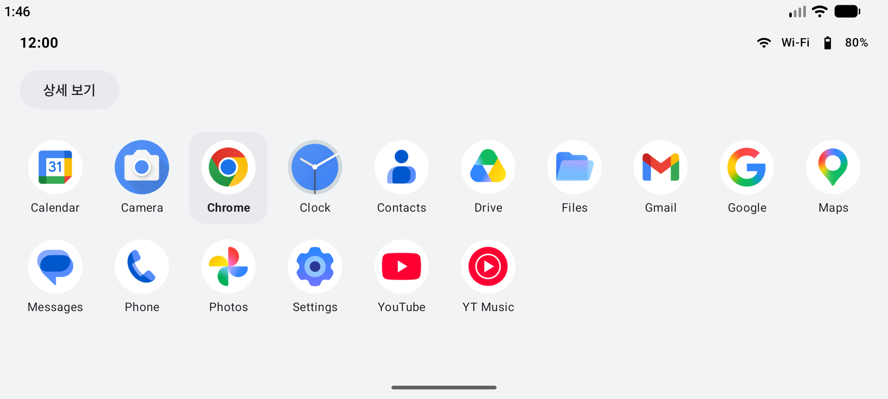
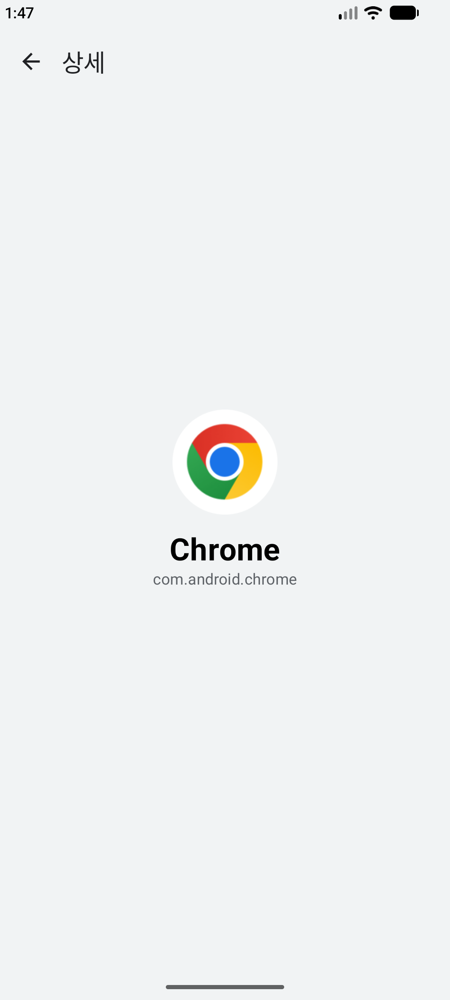
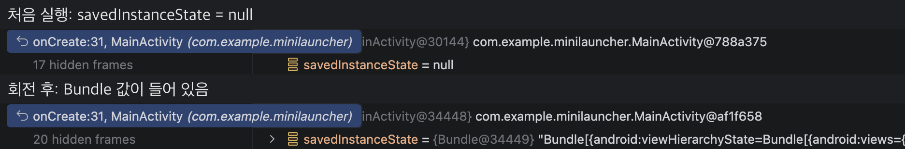

# 1-4 Activity 생명주기와 화면 이동

1일차 15:00~17:00 | [전체 일정으로](../README.md)

`step03_lifecycle` 폴더를 열고 시작합니다.

앞 모듈에서 화면을 돌리면 선택이 사라졌습니다. 왜 그런지 로그와 디버거로 확인합니다. 이 폴더의 코드는 ViewModel로 이미 고쳐 둔 상태라, 돌려도 선택이 남는 차이를 봅니다. 끝에 Intent로 상세 화면도 하나 엽니다.

<p>
</p>

## 따라 하기

### 1. 생명주기 로그 보기

1. 앱을 Run으로 실행합니다.
2. Logcat 검색칸에 `tag:Lifecycle`을 넣습니다.

3. 홈 버튼, 다시 열기, 가로로 돌리기를 해 보며 동작마다 어떤 콜백이 찍히는지 봅니다. 가로로 돌렸다가 다시 세로로 돌리면 이렇게 찍힙니다.

```
D/Lifecycle: onCreate (복원 데이터 없음)
D/Lifecycle: onStart
D/Lifecycle: onResume
D/Lifecycle: LauncherViewModel 생성
D/Lifecycle: onPause
D/Lifecycle: onStop
D/Lifecycle: onDestroy (회전 때문이면 true: true)
D/Lifecycle: onCreate (복원 데이터 있음)
D/Lifecycle: onStart
D/Lifecycle: onResume
D/Lifecycle: onPause
D/Lifecycle: onStop
D/Lifecycle: onDestroy (회전 때문이면 true: true)
D/Lifecycle: onCreate (복원 데이터 있음)
```

`onDestroy` 줄 끝이 `true`인 것은 화면 회전 때문에 없어졌다는 뜻입니다. 그 뒤에 `onCreate`가 다시 찍힙니다. 화면을 돌리면 Activity가 새로 만들어집니다. 1-3(step02)에서 선택이 사라진 이유입니다.

### 2. 브레이크포인트로 멈춰 보기

1. `MainActivity.kt`의 `Log.d(TAG, "onCreate ...` 줄 번호를 눌러 빨간 점을 찍습니다.
2. 위쪽 벌레 모양(Debug)을 누릅니다. 그 줄에서 멈추고 아래 Variables에 `savedInstanceState = null`이 보입니다.
3. Resume(초록 재생 버튼)을 누르고 에뮬레이터를 돌립니다. 같은 줄에서 다시 멈추는데, 이번에는 Bundle 값이 들어 있습니다.

    

4. 빨간 점을 다시 눌러 지우고 Resume을 누릅니다.

### 3. ViewModel로 선택 유지

`LauncherViewModel.kt`를 엽니다. 선택된 앱을 Activity가 아니라 ViewModel이 들고 있습니다. 화면을 돌려도 선택이 남는지 확인합니다. 로그에 `LauncherViewModel 생성`이 처음 한 번만 찍히는 것도 봅니다.

### 4. Intent로 상세 화면 열기

아이콘을 고르고 상세 보기를 누릅니다. `DetailActivity`가 열리고 앱 이름과 패키지 이름이 보입니다. `MainActivity.kt`에서 `Intent(context, DetailActivity::class.java)`와 `putExtra`를 찾아 보고, `DetailActivity.kt`의 `getStringExtra`가 `putExtra`와 같은 키(`EXTRA_LABEL`, `EXTRA_PACKAGE`)를 쓰는지 봅니다.

## 막히면

- 브레이크포인트에서 안 멈춤: Run이 아니라 Debug(벌레 모양)로 실행했는지 확인합니다.
- Logcat에 아무것도 안 보임: 위쪽 기기 선택이 지금 쓰는 에뮬레이터인지, 검색칸 글자가 맞는지 봅니다.

## 더 해 보기

선택한 앱 이름을 상태 영역 가운데에 보여 주고, 화면을 돌려도 남는지 확인합니다.

다음: [2-1 메인 스레드와 Coroutine, Flow](../step04_coroutine)
