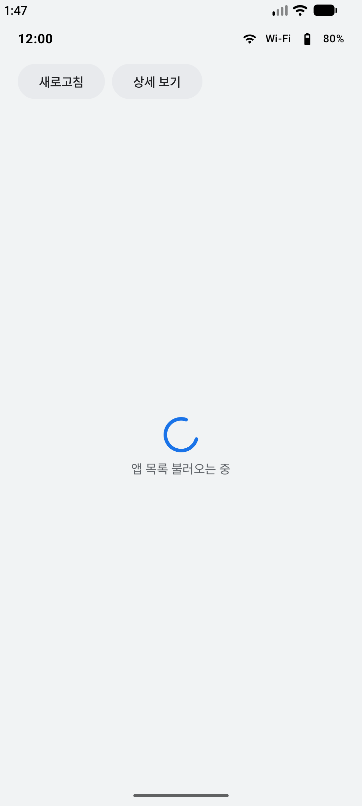
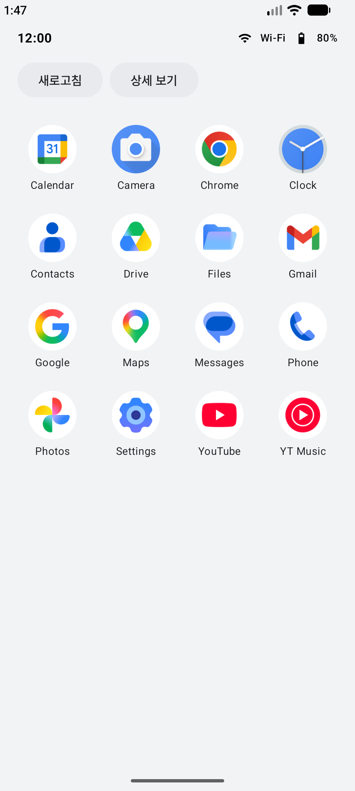
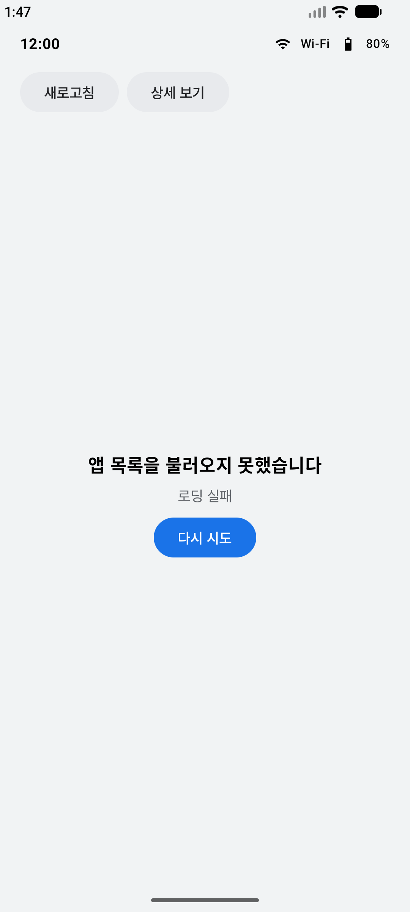
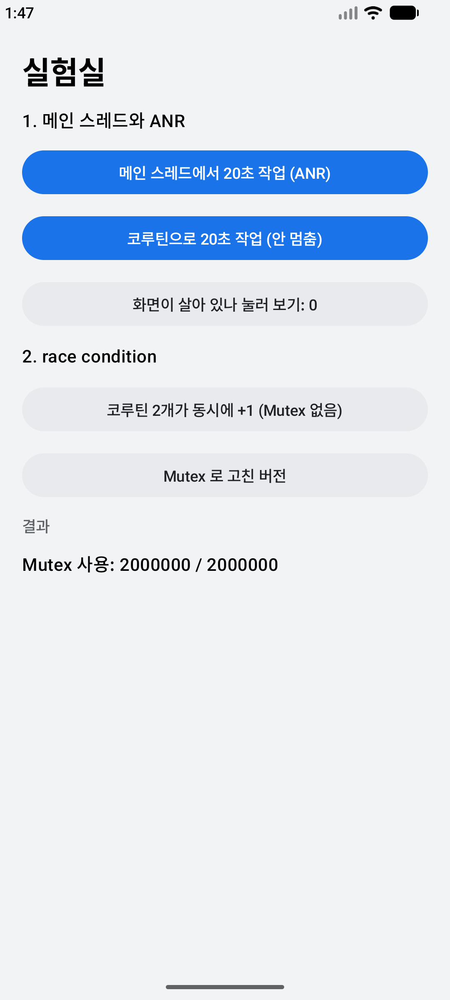
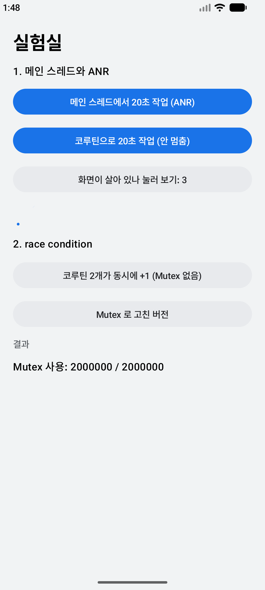

# 2-1 메인 스레드와 Coroutine, Flow

2일차 09:00~12:00 | [전체 일정으로](../README.md)

`step04_coroutine` 폴더를 열고 시작합니다.

메인 스레드를 막으면 무슨 일이 생기는지 직접 겪어 보고, 코루틴으로 고칩니다. 앱 목록을 2초 걸려 불러오는 동안의 화면(불러오는 중, 성공, 실패)을 StateFlow 하나로 나타냅니다.

<p>

</p>

## 따라 하기

### 1. 실험실 열기

앱을 실행하면 앱 서랍에 "실험실" 아이콘이 하나 더 생깁니다. 실험실을 엽니다.



### 2. ANR 만들기

1. "메인 스레드에서 20초 작업"을 누르고, 바로 "화면이 살아 있나 눌러 보기"를 한 번 더 누릅니다.
2. 화면이 멈춥니다. 입력에 반응하지 않은 채 일정 시간이 지나면 시스템이 ANR(앱 응답 없음)로 기록합니다. Android 16은 5초, Android 17은 15초입니다.
3. Logcat 검색칸의 `package:mine`을 지우고 `ANR in`을 넣습니다. ANR 기록은 앱이 아니라 시스템이 남겨서, `package:mine`으로는 안 보입니다.

```
E/ActivityManager: ANR in com.example.minilauncher (com.example.minilauncher/.lab.LabActivity)
E/ActivityManager: Reason: 347e5e5 com.example.minilauncher/com.example.minilauncher.lab.LabActivity is not responding. Waited 15001ms for MotionEvent
```

Android 16에서는 Reason 줄이 `Input dispatching timed out`으로 찍힙니다. 에뮬레이터에 따라 "앱이 응답하지 않습니다" 창은 안 뜰 수 있습니다. 로그로 확인하면 됩니다.

### 3. 코루틴으로 고치기

"코루틴으로 20초 작업"을 누르고 "화면이 살아 있나 눌러 보기"를 여러 번 누릅니다. 숫자가 올라갑니다. `lab/LabActivity.kt`에서 두 버튼의 차이는 `heavyWork()`를 `withContext(Dispatchers.Default)` 안에서 부르는지 하나입니다.

```kotlin
// 메인 스레드를 20초 붙잡음
result = heavyWork()

// 무거운 일은 작업 스레드로, 결과만 메인에서
scope.launch {
    result = withContext(Dispatchers.Default) { heavyWork() }
}
```



### 4. 경쟁 상태(race condition) 만들기

"코루틴 2개가 동시에 +1 (Mutex 없음)"을 누릅니다. 코루틴 두 개가 같은 변수를 100만 번씩 더하는데, 결과가 대부분 200만보다 작습니다(가끔 200만이 나오면 한 번 더 누릅니다). "Mutex 로 고친 버전"은 항상 200만입니다. C++에서 data race를 `std::mutex`로 막는 것과 같은 원리입니다. 코드는 `lab/RaceCounter.kt`에 있습니다.

### 5. StateFlow로 화면 바꾸기

앱 서랍에서 Mini Launcher를 다시 엽니다. 앱 목록을 `FakeAppRepository`에서 받는데, 2초 기다리고 30% 확률로 실패합니다. 새로고침을 몇 번 눌러 세 가지 화면(불러오는 중, 성공, 실패)을 모두 봅니다.

- `LauncherViewModel.kt`: 화면 상태를 `AppsState`(Loading, Error, Success) 하나로 묶어 StateFlow로 내보냅니다.
- `ui/AppsContent.kt`: 화면은 그 상태 하나만 보고 그립니다.

### 6. 테스트

Shift 두 번으로 `CoroutineTest`를 찾아 열고, `class CoroutineTest` 줄 왼쪽 초록 화살표 > Run 'CoroutineTest'로 파일 전체를 실행합니다. 2초 기다림을 가상 시간으로 건너뛰어서 바로 끝납니다.

## 코루틴, 헷갈리는 것 정리

| 질문 | 답 |
|---|---|
| 코루틴은 스레드인가 | 아닙니다. 스레드 위에서 돌다가 `delay`나 `withContext`를 만나면 스레드를 잠시 비켜 주는 작업 단위입니다. 그동안 스레드는 다른 일을 합니다. 그래서 메인 스레드에서 `delay(2000)`은 화면을 멈추지 않고 `Thread.sleep(2000)`은 멈춥니다 |
| suspend는 무엇인가 | 중간에 멈췄다가 이어질 수 있는 함수라는 표시입니다. suspend를 붙인다고 다른 스레드에서 도는 것은 아닙니다 |
| Dispatchers | 어느 스레드에서 돌릴지 고릅니다. Main은 화면, IO는 파일과 네트워크 대기, Default는 계산이 많은 일입니다 |
| scope | 코루틴은 scope에 묶여 있고, scope가 끝나면 같이 취소됩니다. `viewModelScope`는 ViewModel이 사라질 때, `rememberCoroutineScope`는 화면이 사라질 때 끝납니다 |
| Flow와 StateFlow | Flow는 값이 여러 번 흘러나오는 통로입니다. StateFlow는 항상 최신 값 하나를 들고 있어서 화면 상태를 담기에 맞습니다 |
| Mutex | `std::mutex`와 같은 역할입니다. 기다리는 동안 스레드를 막지 않고 코루틴만 멈춥니다 |

더 읽을 거리: [Kotlin coroutines on Android](https://developer.android.com/kotlin/coroutines), [Coroutines basics](https://kotlinlang.org/docs/coroutines-basics.html), [StateFlow and SharedFlow](https://developer.android.com/kotlin/flow/stateflow-and-sharedflow)

## 더 해 보기

가짜 지연을 5초로 늘리고, 불러오는 중에 새로고침을 여러 번 눌러 봅니다. 여러 번 누르면 불러오기가 겹쳐서 화면 상태가 여러 번 바뀝니다. 새로 누를 때 이전 `Job`을 `cancel()`해서 마지막 요청만 화면에 반영되게 고칩니다.

다음: [2-2 시스템 이벤트 감지](../step05_receiver)
