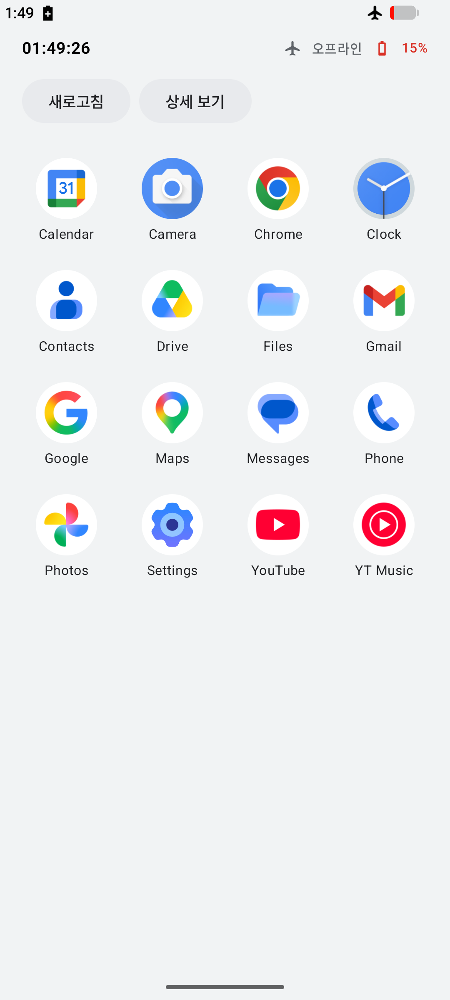
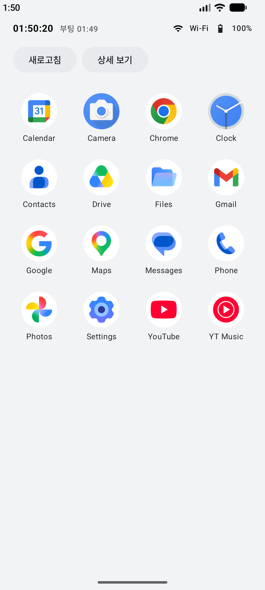

# 2-2 시스템 이벤트 감지 (BroadcastReceiver)

2일차 13:00~15:00 | [전체 일정으로](../README.md)

`step05_receiver` 폴더를 열고 시작합니다.

상태 영역의 고정 값(12:00, Wi-Fi, 80%)을 시스템에서 받은 실제 값으로 바꿉니다. 배터리, 네트워크, 부팅 완료 이벤트를 받습니다.

<p>

</p>

## 따라 하기

### 1. 배터리

1. 앱을 실행합니다.
2. 에뮬레이터 옆 ⋮(Extended Controls) > Battery에서 Charge level을 15%로 내립니다. 상태 영역의 배터리가 빨간색으로 바뀝니다.
3. Charger connection을 AC charger로 바꾸면 "충전 중"이 붙습니다.
4. `system/SystemStatus.kt`의 `rememberBattery`를 봅니다. `registerReceiver`로 등록하고 `onDispose`에서 `unregisterReceiver`로 해제합니다. 등록과 해제는 항상 짝입니다.

### 2. 네트워크

에뮬레이터 위쪽을 끌어내려 비행기 모드를 켭니다. 상태 영역이 "오프라인"으로 바뀝니다. 예전 방송(CONNECTIVITY_ACTION) 대신 `ConnectivityManager.NetworkCallback`을 씁니다.

Logcat 검색칸에 `tag:SystemEvent`를 넣으면 이렇게 찍힙니다.

```
D/SystemEvent: 배터리 변경: BatteryInfo(level=15, charging=false)
D/SystemEvent: 네트워크: 끊김
D/SystemEvent: 배터리 변경: BatteryInfo(level=15, charging=false)
D/SystemEvent: 배터리 변경: BatteryInfo(level=15, charging=true)
```

### 3. 부팅 완료

`AndroidManifest.xml`에 등록한 `BootReceiver`는 앱이 꺼져 있어도 시스템이 깨워서 부릅니다.

1. 앱을 한 번 실행합니다. Android Studio의 Stop(빨간 네모)은 누르지 않습니다. Stop은 앱을 강제 종료해서 부팅 방송을 못 받게 만듭니다.
2. 에뮬레이터 전원 버튼을 길게 누르고 Restart를 고릅니다(1~2분 걸립니다). 전원 메뉴가 안 뜨면 Device Manager에서 그 기기의 ⋮ > Cold Boot Now를 누릅니다.
3. 다시 켜지면 앱을 엽니다. 상태 영역에 "부팅 시각"이 생겼으면 성공입니다.

재부팅 직후에는 로그가 많아서 Logcat의 "부팅 완료 수신" 줄이 밀려 지워질 수 있습니다. 상태 영역의 부팅 시각으로 확인합니다.

### 4. 1초 시계

`rememberClock`은 `produceState` 안의 코루틴이 1초마다 시각을 바꿉니다. 화면이 사라지면 같이 멈춥니다.

## 막히면

- 부팅 시각이 안 생김: 재부팅 전에 앱을 한 번 열었는지, Stop을 누르지 않았는지 확인합니다.
- 앱 목록이 에러로 뜸: step05_receiver 폴더를 열었는지 확인합니다. 이 단계부터는 실패 확률이 0입니다.

## 더 해 보기

배터리가 20% 아래로 내려가는 순간 Toast를 한 번만 띄웁니다. 20% 근처를 오르내릴 때 여러 번 뜨지 않게 합니다.

다음: [2-3 백그라운드 처리](../step06_service)
