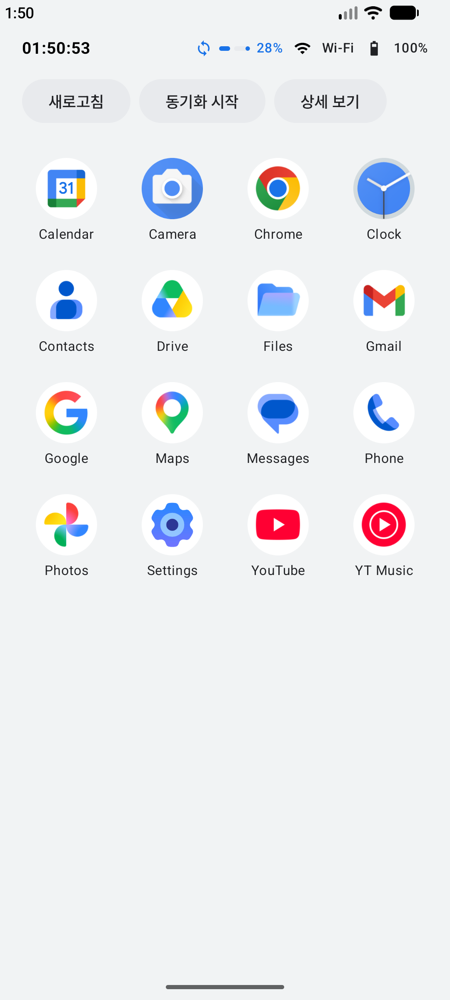
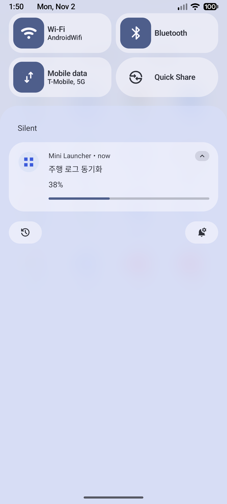
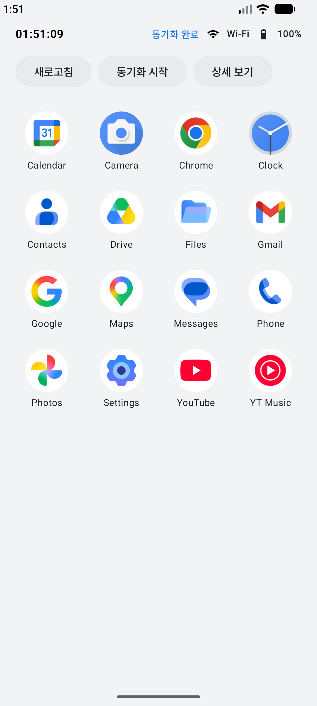

# 2-3 백그라운드 처리 (Service, Notification)

2일차 15:00~17:00 | [전체 일정으로](../README.md)

`step06_service` 폴더를 열고 시작합니다.

화면이 꺼져도 계속 도는 작업을 Foreground Service로 만들고, 진행률을 알림과 상태 영역에 함께 보여 줍니다.

<p>

</p>

## 따라 하기

1. 앱을 실행하고 "동기화 시작"을 누릅니다.
2. 알림 권한을 묻는 창이 뜨면 "허용"을 누릅니다. 두 번 거부하면 창이 다시 뜨지 않으니, 그때는 에뮬레이터의 Settings > Apps > Mini Launcher > Notifications에서 켭니다.
3. 상태 영역에 진행률(%)이 올라갑니다. 약 20초 뒤 "동기화 완료"가 됩니다.
4. 진행 중에 에뮬레이터 위쪽을 끌어내립니다. 동기화 알림은 중요도를 낮게 둬서 아래쪽 Silent 칸에 들어 있습니다. 펼치면 진행 막대가 보입니다.
5. Logcat 검색칸에 `tag:SyncService`를 넣고, 완료된 뒤 도구막대의 ◁(Back)으로 앱 화면을 닫아 봅니다. 앱을 열 때 이미 `onBind`와 "화면이 Service 에 연결됨"이 찍혀 있고, 동기화 시작부터는 이렇게 이어집니다.

```
D/SyncService: onStartCommand
D/SyncService: 동기화 완료
D/SyncService: onUnbind
D/SyncService: onDestroy
```

## 코드에서 볼 곳

| 파일 | 볼 점 |
|---|---|
| `AndroidManifest.xml` | `<service>`에 `foregroundServiceType="dataSync"`가 있습니다. Android 14부터 꼭 적어야 합니다 |
| `service/SyncService.kt` | `startForeground`로 알림을 붙이고, 0.4초마다 2%씩 올립니다. `FOREGROUND_SERVICE_IMMEDIATE`는 알림이 10초 늦게 뜨는 것을 막습니다 |
| `service/SyncConnection.kt` | 화면이 `bindService`로 Service에 붙어 진행률(StateFlow)을 받습니다 |

동기화가 끝나 `stopSelf()`를 불러도, 화면이 붙어(bind) 있는 동안은 Service가 살아 있습니다. 뒤로 가기로 화면을 닫으면 그제야 `onUnbind`, `onDestroy`가 찍힙니다. startService와 bindService를 같이 쓰면, `stopSelf()`가 불리고 연결된 화면도 모두 떨어져야 Service가 끝납니다.

## 막히면

- 알림이 안 보임: 권한을 거부했거나 Silent 칸을 펼치지 않은 경우입니다.
- `onDestroy`가 안 찍힘: 앱 화면이 아직 열려 있으면 정상입니다. 뒤로 가기로 닫습니다.

## 더 해 보기

동기화 중에 "동기화 시작"을 다시 누르면 어떻게 되는지 로그로 확인하고, 진행 중에는 버튼을 누를 수 없게 바꿉니다.

다음: [3-1 HomeScreen(Launcher) 만들기](../step07_launcher)
