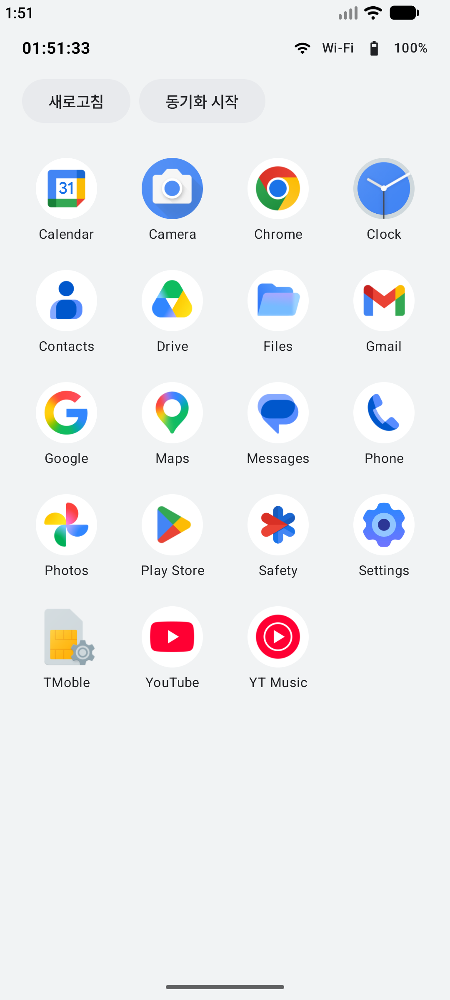
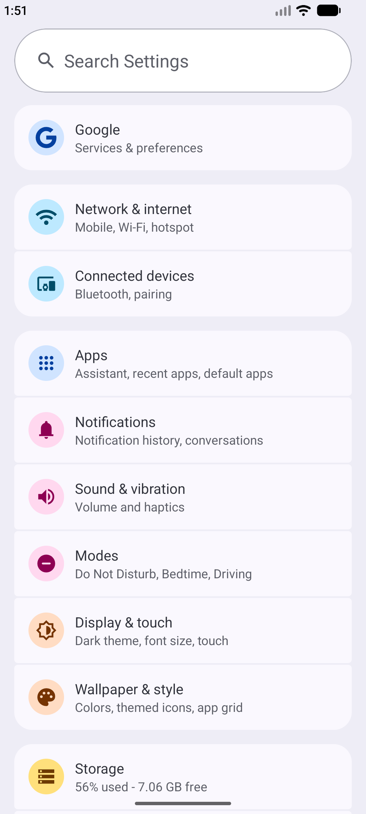
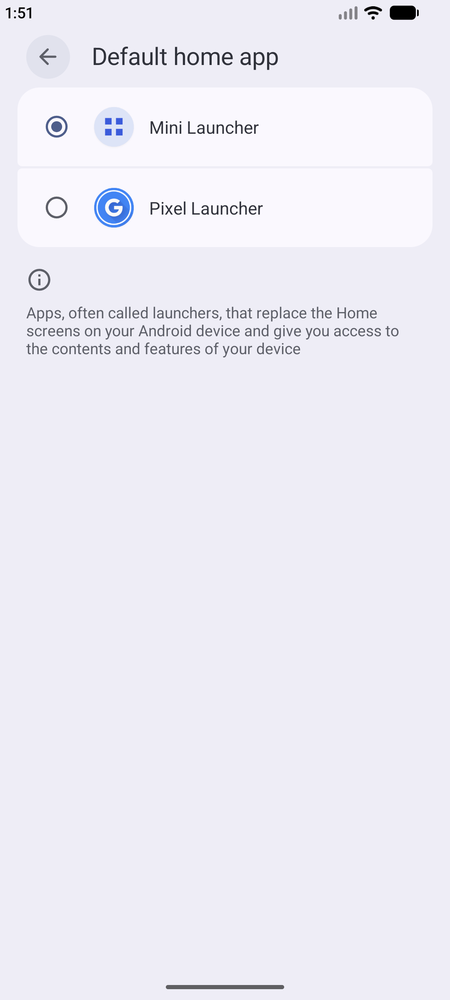

# 3-1 HomeScreen(Launcher) 만들기

3일차 09:00~12:00 | [전체 일정으로](../README.md)

`step07_launcher` 폴더를 열고 시작합니다.

고정 목록을 에뮬레이터에 실제로 설치된 앱으로 바꿉니다. 마지막에는 이 앱을 기본 홈 앱으로 등록해서 홈 버튼에 연결합니다.

## 따라 하기

### 1. 설치된 앱 목록

1. 앱을 실행합니다. 고정 16개가 아니라 에뮬레이터에 실제로 설치된 앱이 모두 나옵니다.
2. `data/InstalledAppRepository.kt`를 엽니다. `PackageManager.queryIntentActivities`로 "앱 서랍에 보일 앱(MAIN + LAUNCHER)"을 묻습니다.
3. `LauncherViewModel.kt`는 2일차와 거의 같습니다. `AppRepository` 인터페이스 덕분에 가짜 목록을 실제 목록으로 바꿔 끼웠습니다.

### 2. `<queries>`를 지워 보기

1. `AndroidManifest.xml`에서 `<queries> ... </queries>` 덩어리를 지우고 다시 실행합니다.
2. 앱이 몇 개만 남습니다. Android 11부터는 다른 앱을 보려면 무엇을 찾을지 Manifest에 미리 적어야 합니다(패키지 공개 범위).
3. 확인했으면 Edit > Undo로 되돌립니다.

### 3. 앱 실행과 상세 화면

- 아이콘을 누르면 그 앱이 열립니다. `AppLauncher.kt`의 `launchApp`은 패키지와 클래스를 지정한 명시적 Intent를 씁니다.
- 아이콘을 길게 누르면 상세 화면에 실제 패키지 이름이 나옵니다.

### 4. 기본 홈 앱으로 등록

1. `AndroidManifest.xml`의 MainActivity에 `HOME`과 `DEFAULT` 카테고리가 있는지 봅니다.
2. 에뮬레이터에서 Settings > Apps > Default apps > Home app을 엽니다.
3. Mini Launcher를 고릅니다.
4. 홈 버튼을 누릅니다. 직접 만든 화면이 뜹니다.

## 막히면

- 홈 앱 목록에 Mini Launcher가 없음: 이 단계 코드(step07_launcher)를 실행했는지 확인합니다. 앞 단계에는 HOME 카테고리가 없습니다.
- 홈 화면에서 뒤로 가기가 안 먹음: 런처가 닫히지 않게 `BackHandler`로 막아 둔 것입니다.

## 더 해 보기

앱이 설치되거나 지워지면(`ACTION_PACKAGE_ADDED`, `ACTION_PACKAGE_REMOVED`) 목록을 다시 불러옵니다.

다음: [3-2 Logcat 로그 분석](../step07x_bughunt)
