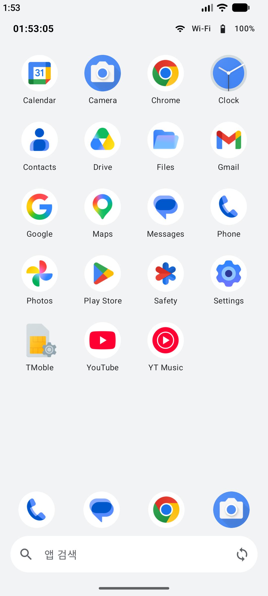
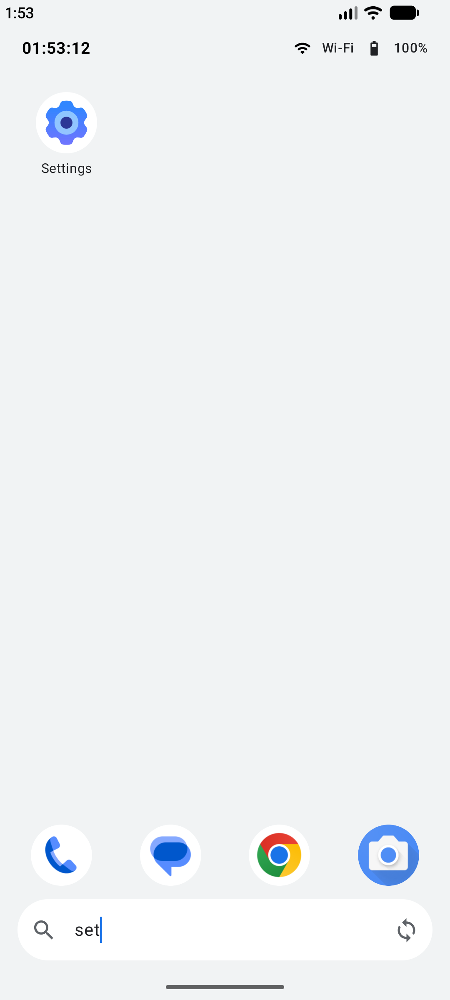
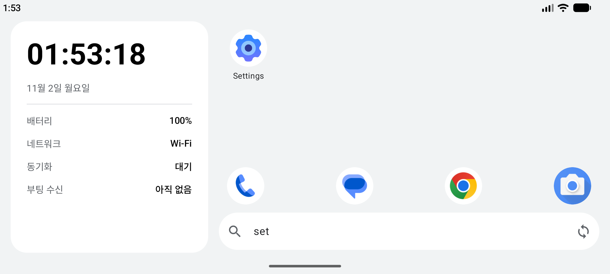

# 3-3 미니 런처 완성과 코드 리뷰

3일차 15:00~17:00 | [전체 일정으로](../README.md)

`step08_final` 폴더를 열고 시작합니다.

검색, 도크, 가로 화면을 더해 미니 런처를 완성합니다. 마지막으로 3일 동안 만든 상태가 각각 어디에 있는지 정리합니다.

## 따라 하기

1. 앱을 실행하고 홈 버튼을 누릅니다(3-1에서 기본 홈 앱으로 등록했다면 바로 이 화면이 뜹니다).
2. 맨 아래 검색창에 `set`을 넣습니다. Settings만 남습니다. 에뮬레이터를 돌려도 검색어가 남습니다.
3. 도크(Phone, Messages, Chrome, Camera)의 아이콘을 눌러 앱을 엽니다.
4. 동기화는 검색창 오른쪽 동그란 화살표 아이콘으로 시작합니다.
5. 가로로 돌립니다. 왼쪽에 시계, 배터리, 네트워크, 동기화, 부팅 수신을 모은 정보 패널이 생깁니다. 태블릿처럼 넓은 화면을 나눠 쓰는 연습입니다.

## 코드에서 볼 곳

| 파일 | 볼 점 |
|---|---|
| `MainActivity.kt` | 검색어는 `rememberSaveable`이라 화면을 돌려도 남습니다. 1일차의 `remember`와 비교합니다. 가로, 세로에 따라 배치를 나눕니다 |
| `model/AppFilter.kt` | 검색과 도크를 고르는 함수입니다. 화면과 떨어져 있어서 `AppFilterTest`로 테스트합니다 |
| `ui/Dock.kt`, `ui/SearchField.kt`, `ui/InfoPanel.kt` | 새로 더한 화면 조각입니다 |

## 코드 리뷰: 상태는 어디에 있나

3일 동안 화면에 보인 값이 각각 어디에 저장되는지 정리하면 이렇습니다.

| 화면에 보이는 값 | 들고 있는 곳 | 화면을 돌리면 | 앱을 닫으면 |
|---|---|---|---|
| 선택한 앱 | `LauncherViewModel`의 StateFlow | 남음 | 사라짐 |
| 검색어 | `rememberSaveable` | 남음 | 사라짐 |
| 앱 목록 | `LauncherViewModel` (처음 한 번 불러옴) | 남음 | 다시 불러옴 |
| 배터리, 네트워크 | 화면이 보이는 동안 등록한 Receiver와 콜백 | 다시 등록 | 해제 |
| 동기화 진행률 | `SyncService`의 StateFlow | 남음 | Service가 끝날 때까지 남음 |
| 부팅 시각 | SharedPreferences (`BootReceiver`가 저장) | 남음 | 남음 |

직접 고친 코드가 있으면, 고친 값이 위 표의 어느 줄에 해당하는지, 화면을 돌렸을 때 표대로 남는지 에뮬레이터에서 확인합니다.

## 수업이 끝나면

1. Settings > Apps > Default apps > Home app에서 Pixel Launcher로 되돌립니다.
2. 에뮬레이터에서 Mini Launcher를 지웁니다(실험실도 같은 앱이라 함께 지워집니다).

## 더 해 보기

검색 결과가 없으면 "찾는 앱이 없습니다"를 보여 주고, 도크 앱을 길게 누르면 지금 선택한 앱으로 바뀌게 합니다.

[전체 일정으로](../README.md)
